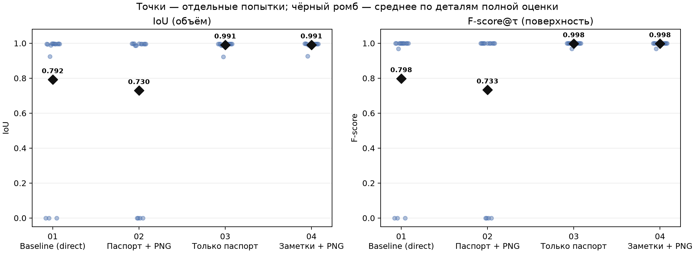
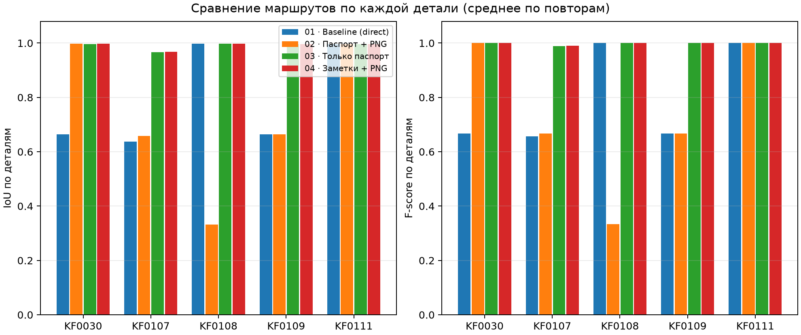
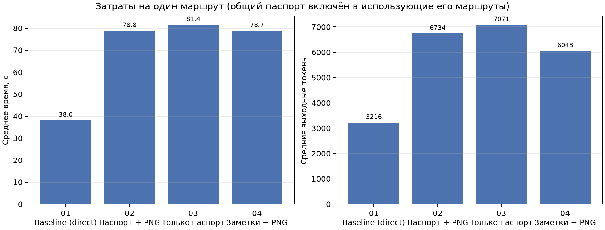
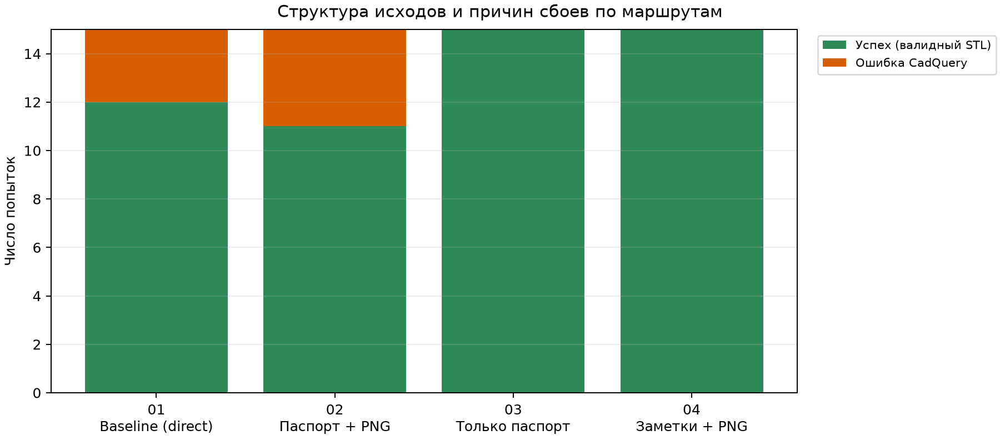

# Исследование №1: влияние структурированного паспорта чертежа (`01-drawing-passport`)

## Кратко

Проверяем, помогает ли предварительное структурированное чтение инженерного чертежа перед генерацией CAD-рецепта. При единой модели, едином общем бюджете и одном построении CadQuery сравниваются 4 эксперимента (по отдельной папке с `pipeline.yaml`, `llm.yaml`, `cad.yaml`, `evaluation.yaml` внутри [configs/experiments/01-drawing-passport/](configs/experiments/01-drawing-passport/)):

- [`01_baseline_direct`](configs/experiments/01-drawing-passport/01_baseline_direct/pipeline.yaml) — **baseline** (`direct`: однопроходная генерация `PNG → рецепт → STL`);
- [`02_passport_png`](configs/experiments/01-drawing-passport/02_passport_png/pipeline.yaml) — **основное улучшение** (`passport_png`: `PNG → строгий JSON-паспорт; паспорт + PNG → рецепт → STL`);
- [`03_passport_only`](configs/experiments/01-drawing-passport/03_passport_only/pipeline.yaml) — **абляция 1** (`passport_only`: отключение PNG на 2-м этапе, построитель получает только JSON-паспорт);
- [`04_notes_png`](configs/experiments/01-drawing-passport/04_notes_png/pipeline.yaml) — **абляция 2** (`notes_png`: отключение строгой JSON-схемы, построитель получает свободные текстовые заметки + PNG).

Паспорт исследования задан в [study.yaml](configs/experiments/01-drawing-passport/study.yaml), а [src/core/config.py](src/core/config.py) при загрузке автоматически проверяет равенство `llm.yaml`, `cad.yaml` и `evaluation.yaml` между всеми папками экспериментов.

---

## Исследовательские гипотезы и абляции

| Вариант | Роль | Этап 1 (чтение) | Этап 2 (построитель) | Проверяемая гипотеза |
|---|---|---|---|---|
| `01_baseline_direct` | Baseline | — | PNG + `orientation` | Контрольная точка отсчёта (однопроходная генерация) |
| `02_passport_png` | Улучшение | PNG + `orientation` | Паспорт JSON + PNG + `orientation` | Предварительное извлечение видов, элементов и размеров снизит пропуски и ошибки привязки |
| `03_passport_only` | Абляция 1 (`02_passport_png`) | PNG + `orientation` | Только паспорт JSON + `orientation` | Проверяет, достаточно ли одного структурированного паспорта без повторного доступа к PNG |
| `04_notes_png` | Абляция 2 (`02_passport_png`) | PNG + `orientation` | Заметки Markdown + PNG + `orientation` | Проверяет вклад именно строгой Pydantic-схемы и валидации ссылок относительно свободного текста |

**Критерий улучшения:** рост среднего `F-score` без снижения среднего `IoU` и доли валидных тел относительно `01_baseline_direct`. Разнонаправленные сдвиги или отрицательный результат фиксируются явно без подгонки критериев.

---

## Данные, сплит и контроль утечек

Единый [манифест датасета](data/manifest.json) содержит **15 однолистовых чертежей** из исправленного выпуска `20261115-v2` КОМПАС-3D v25 Study:

- **10 `dev`** (отладка и [EDA](notebooks/EDA.ipynb)): `KF0011`, `KF0012`, `KF0016`, `KF0017`, `KF0018`, `KF0019`, `KF0025`, `KF0027`, `KF0029`, `KF0031`.
- **5 `val`** (формальная проверка):

| Деталь `val` | Семейство (`family`) | Особенности и ограничения геометрии |
|---|---|---|
| `KF0030` · Фланец | `shaft_six_hole_flange` | Осевые ступени, `Z=0` слева, чередующиеся группы крепежа; M8 приближена цилиндром |
| `KF0107` · Втулка со сквозным пазом | `tutorial_internal_keyways` | Длина 133, расточка, M20LH; винтовая поверхность приближается рецептом |
| `KF0108` · Деталь с пазом долбяком | `tutorial_internal_keyways` | Ø60, длина 95, поперечное отверстие; коническое дно полости |
| `KF0109` · Втулка с пазами | `tutorial_internal_keyways` | Ø50, длина 95, согласованное дно паза 15,775 мм; левая коническая полость |
| `KF0111` · Вал с сегментными пазами | `tutorial_segment_keyways` | Длина 120, положение сегментных пазов; радиусы выходов приближаются |

**Автоматический контроль честности (при `exp check` и перед каждым `exp run`):**
1. Группа `KF0107`/`KF0108`/`KF0109` целиком отнесена к `val`; близкий вариант `KF0106` исключён.
2. Пересечение `family` и `sha256` входных/целевых файлов между `dev` и `val` блокируется.
3. Все 15 пар подтверждены однолистовыми (`sheet_count == 1`), эталоны замкнуты и лежат в `Z >= 0`.
4. В контекст модели передаются **только** уменьшенный PNG и `orientation` — поля `target_mesh`, `preparation`, `review` и `limitations` в запросы не попадают.

---

## Протокол честного сравнения и параллельность

| Условие | Зафиксированное значение |
|---|---|
| Модель и рассуждения | `gpt-6.1-sol`, `reasoning_effort = medium` |
| Бюджет маршрута | `900 с`, `16384` выходных токенов (включая reasoning) |
| Бюджет чтения (этап 1) | `≤ 8192` токенов; построитель получает остаток бюджета времени и токенов |
| Повторы и сборка | `repeats = 3`, `order_seed = 20261115`, `1` построение CadQuery; автоповторов LLM нет |
| Подготовка PNG | Длинная сторона ≤ `4096 px` (LANCZOS, пропорции сохраняются), `detail = high` |
| Оценка | Офлайн, `surface_samples = 8192`, `seed = 20261107`, `tau_relative = 0.01` |

- **Дедупликация общего паспорта:** внутри `(pair_id, repeat)` используется `asyncio.Lock`, поэтому `02_passport_png` и `03_passport_only` делят **один** сохранённый `passport.json`. В сводном расходе (`physical_usage`) чтение паспорта учитывается физически один раз, а в логический бюджет каждого маршрута включается полностью.
- **Единый знаменатель:** любая ошибка генерации (JSON, схема, лимит токенов, ошибка CadQuery, незамкнутый STL) даёт `0.0`; инфраструктурный сбой считается пропуском и не позволяет закрыть серию как полную.

---

## Результаты исследования №1

### 1. Итоговая формальная валидация `val` (`01-drawing-passport-val-all-r3`)

Полный отчёт: [results/01-drawing-passport-val-all-r3/report.md](results/01-drawing-passport-val-all-r3/report.md) · Построчная таблица: [runs.csv](results/01-drawing-passport-val-all-r3/runs.csv) · Машинный свод: [summary.json](results/01-drawing-passport-val-all-r3/summary.json).

- **Объём серии:** `60/60` ячеек матрицы (5 деталей × 3 повтора × 4 варианта), инфраструктурных сбоев — **0**.
- **Физический расход:** `90` этапов LLM (`508 148` входных токенов, `292 436` выходных токенов, `3513,1 с` суммарного времени этапов).

| Вариант | Роль | Валидность | IoU (все 15) | F-score (все 15) | IoU (валидные) | F-score (валидные) | Время, с | Токены (вых) |
|---|---|---:|---:|---:|---:|---:|---:|---:|
| `01_baseline_direct` | Baseline | `12/15` (`0,8000`) | `0,792018 ± 0,187568` | `0,797914 ± 0,184528` | `0,990023` | `0,997392` | `38,0` | `3216` |
| `02_passport_png` | Улучшение | `11/15` (`0,7333`) | `0,729771 ± 0,278465` | `0,733333 ± 0,278887` | **`0,995143`** | **`1,000000`** | `78,8` | `6734` |
| `03_passport_only` | Абляция 1 | **`15/15` (`1,0000`)** | **`0,990698 ± 0,013800`** | **`0,997841 ± 0,004827`** | `0,990698` | `0,997841` | `81,4` | `7071` |
| `04_notes_png` | Абляция 2 | **`15/15` (`1,0000`)** | **`0,991329 ± 0,012972`** | **`0,997901 ± 0,004693`** | `0,991329` | `0,997901` | `78,7` | `6048` |

#### Парные сравнения и абляции (`val`)

| Сравнение | Проверяемый вопрос | Δ IoU | Δ F-score | Δ Валидность | Итог по критерию |
|---|---|---:|---:|---:|---|
| `02_passport_png − 01_baseline_direct` | Помогает ли паспорт + PNG относительно baseline? | `-0,062247` | `-0,064580` | `-0,066667` | Без прироста (из-за 4 сбоев CAD на шаге 2) |
| `03_passport_only − 01_baseline_direct` | Превосходит ли один только паспорт baseline? | **`+0,198680`** | **`+0,199928`** | **`+0,200000`** | Критерий улучшения выполнен |
| `02_passport_png − 03_passport_only` | Вклад повторного просмотра PNG поверх паспорта | `-0,260927` | `-0,264508` | `-0,266667` | В среднем хуже из-за сбоев CAD (`11/15` vs `15/15`) |
| `02_passport_png − 04_notes_png` | Вклад строгой JSON-схемы против заметок | `-0,261558` | `-0,264568` | `-0,266667` | Без прироста по средним (`11/15` vs `15/15`) |

### 2. Полный прогон на `dev` (`01-drawing-passport-dev-all-r1`, 10 деталей × 1 повтор)

Полный отчёт: [results/01-drawing-passport-dev-all-r1/report.md](results/01-drawing-passport-dev-all-r1/report.md) · Машинный свод: [summary.json](results/01-drawing-passport-dev-all-r1/summary.json).

- **Валидность:** **`40/40` (`100%` по всем 4 вариантам)**; все 10 `dev`-деталей, включая сложные шестерни `KF0011`, `KF0012`, `KF0025`, `KF0029`, построились без единого CAD-сбоя.
- **Метрики на `dev`:**
  - `01_baseline_direct`: `IoU = 0,933127`, `F-score = 0,938002` (`38,1 с`, `2613` вых. токенов);
  - `02_passport_png`: `IoU = 0,935641` (`+0,002515`), `F-score = 0,945894` (`+0,007892`) — лучший `F-score` (особенно заметно улучшение на `KF0011`: `F-score` вырос с `0,5071` до `0,5780`);
  - `03_passport_only`: `IoU = 0,936239` (`+0,003112`), `F-score = 0,945675` (`+0,007672`);
  - `04_notes_png`: `IoU = 0,934671` (`+0,001544`), `F-score = 0,945134` (`+0,007132`).

---

## Анализ ошибок, абляций и выводов

1. **Природа всех 7 сбоев на `val` (3 в `01_baseline_direct`, 4 в `02_passport_png`):**
   - Каждый из 7 рецептов (`KF0030` r1, `KF0107` r1/r3, `KF0108` r1/r3, `KF0109` r3) упал ровно на **шаге 2** с ошибкой `Шаг 2: требуется одно корректное объёмное тело`.
   - Причина одна и та же во всех 7 случаях: модель сначала строила основной цилиндр выше торцевой фаски (`z=1,0` или `z=1,6`), а на шаге 2 пыталась выложить самый нижний тонкий срез фаски (`z=0,0`, `depth=0,25` или `0,4`), оставляя воздушный зазор до шагов 3–5, которые должны были соединить фаску с телом.
   - Поскольку [src/cad/builder.py](src/cad/builder.py) проверяет одно связное тело после **каждого** шага, модель отбрасывалась уже на шаге 2, хотя 11 валидных прогонов `02_passport_png` набрали `IoU = 0,9951` и `F-score = 1,0000`.
   - По правилам честного сравнения мы **не** правили `builder.py` задним числом под `val`.
2. **Резюме по абляциям:**
   - **Абляция 1 (отключение PNG у построителя — `03_passport_only`):** дала `15/15` валидности и `+0,199 IoU / +0,200 F-score` к baseline. Наличие готового структурированного паспорта полностью достаточно для точной 3D-реконструкции деталей этого класса, а отсутствие повторного PNG в 2-м этапе даже избавило модель от лишнего визуального шума/токенов на фасках и снизило входные токены (`10 760` против `13 734`).
   - **Абляция 2 (заметки вместо JSON-паспорта — `04_notes_png`):** также дала `15/15` и сопоставимую точность (`IoU = 0,9913`, `F-score = 0,9979`) при меньшем расходе выходных токенов (`6048` против `7071`). Это честный нулевой результат по гипотезе «строгая JSON-схема обязательна для точности»: главную пользу даёт **сам двухэтапный проход «сначала чтение и инвентаризация размеров, затем построение»**, а строгий JSON нужен прежде всего для проверяемости и переиспользования в инженерном пайплайне.
3. **Урок для следующей итерации:** однократный цикл исправления CAD-ошибки (`02-cad-repair`) или правило промпта строить фаски от уже существующей грани (от большего `r` к меньшему) на порядок важнее дальнейшего усложнения этапа чтения.

---

## Отладка и исправления CAD-пайплайна (на `dev` до финальных запусков)

На ранних и отладочных запусках (сохранённых в `.local-archive/`) были выявлены и устранены причины сбоев чтения и построения CAD (после чего на полном `dev` получено `40/40` валидных STL):

1. **Обрыв по лимиту 8192 токенов на паспорте** → в [prompts/drawing_passport.md](prompts/drawing_passport.md) задан компактный вывод без отступов.
2. **Отклонение корректных значений в `Passport`** → в [src/schemas/passport.py](src/schemas/passport.py) (`drawing-passport-2`) добавлена единица `dimensionless` и отдельный список `general_notes`.
3. **Обрыв контура `Polygon` на 128 точках (`maxItems: 128` в Structured Outputs)** при описании зубчатых венцов → в [src/schemas/recipe.py](src/schemas/recipe.py) лимит вершин `Polygon.points` повышен до `512` (без `maxItems` в JSON Schema), лимит шагов увеличен с `40` до `64`, добавлена склейка микродубликатов (`< 1e-5` мм) и очистка повтора первой вершины; в [prompts/cad_builder.md](prompts/cad_builder.md) добавлены правила про полную аппроксимацию зубьев и безопасный выход пазов.
4. **Перекрывающиеся CSG-шаги и ошибки OCCT** → в [src/cad/builder.py](src/cad/builder.py) и [src/cad/worker.py](src/cad/worker.py) добавлена защита от сбоев `.clean()`, учёт перекрывающихся шагов в `cad.noop_steps` без срыва валидной сборки и классификация `Standard_Failure` как ошибки генерации.

---

## Архитектура, хранение и MLflow 3.18

- **Промпты как код (`prompts/*.md`):** версионируются в Git, проверяются по SHA256 и зеркалируются в MLflow Prompt Registry при изменении текста (`cad-builder`, `drawing-passport`, `drawing-notes`).
- **Реестр стратегий (`src/pipelines/`):** новые гипотезы (`02-cad-repair`, `03-visual-critique`) добавляются классом в [src/pipelines/strategies.py](src/pipelines/strategies.py) и новой папкой `configs/experiments/<номер>-<идея>/` (`study.yaml` и подпапки экспериментов с `pipeline.yaml`, `llm.yaml`, `cad.yaml`, `evaluation.yaml`) без дублирования раннера, оценщика и трекера.
- **Хранение `runs/`, `results/` и `mlflow/`:**
  - `runs/<study>/`: в Git хранятся рецепты (`recipe.json`), паспорта (`passport.json`), заметки (`notes.md`), сгенерированные `model.stl`, журналы и оценки (`record.json`, `evaluation.json`, `run.log`, `study.json`); через `.gitignore` исключены только сырые HTTP-дампы `debug/` и `runs/_manual/`.
  - `results/<study>/`: готовые отчёты `report.md`, `runs.csv`, `summary.json`, `evaluations.json` и 5 типов графиков.
  - `mlflow/`: переносимая БД SQLite (`tracking.db`) с относительными путями `mlflow/artifacts/...`, иерархией `Experiment → Parent Run (<study>) → 4 Child Runs (01..04)`, трассами OpenAI Agents SDK + `cad_build`, группировкой **Sessions** (`<study>/<pair_id>-r<repeat>`), оценками `log_feedback` (`iou`, `f_score`, `valid`) и командой очистки `uv run poe exp purge --study <name>`.
