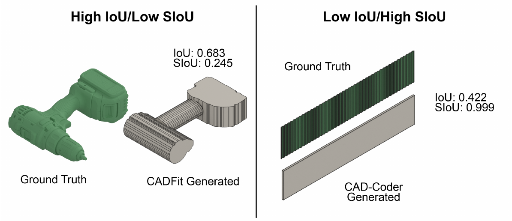
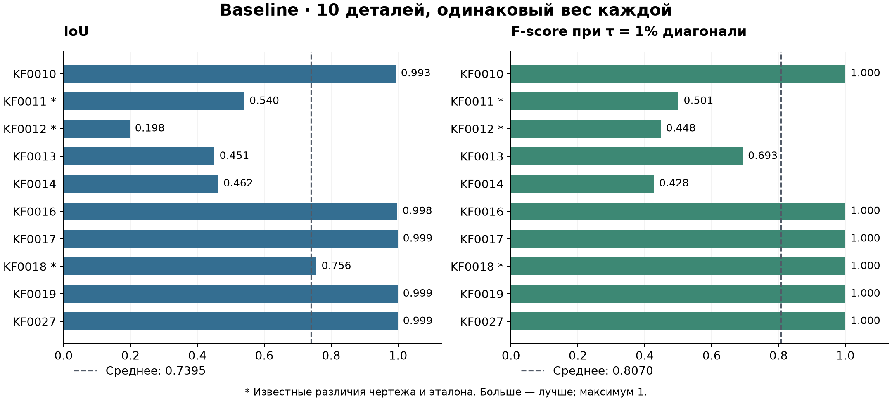
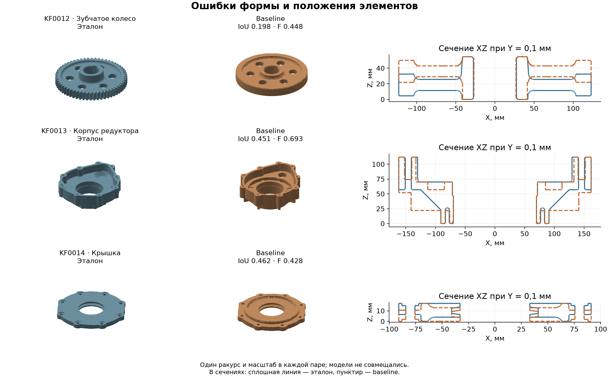

# Генерация 3D модели по изображению чертежа объекта в CAD системах

## Кратко

Проект исследует, может ли мультимодальная языковая модель восстановить геометрию
механической детали по изображению её чертежа. Данный R&D проект содержит:
постановка задачи, простой baseline и воспроизводимая оценка на 10 деталях - от инженерного чертежа к 3D-модели

**CAD** — *Computer-Aided Design*, автоматизированное проектирование. Такие системы
помогают инженерам создавать чертежи и пространственные модели деталей: например,
втулок, валов, шестерён и корпусов. Модель нужна, чтобы изучать форму изделия,
проверять сопряжения и готовить дальнейшую конструкторскую работу.
[Краткое объяснение CAD](https://www.autodesk.com/solutions/cad-software).

Эта работа — подпроект моей ВКР: в большом исследовании я рассматриваю генерацию
модели с **редактируемым деревом операций в КОМПАС-3D** — последовательностью эскизов,
выдавливаний и вырезов. Для ДЗ задача упрощена: построение выполняет
[CadQuery](https://cadquery.readthedocs.io/en/latest/intro.html), поэтому запуск
не требует КОМПАС-3D и привязки к Windows.

Результат сохраняется в **STL** — формате, который описывает поверхность объекта
треугольниками и широко используется для просмотра и 3D-печати. Он удобен для
переноса моделей и геометрического сравнения, но приближает кривые поверхности,
не хранит дерево CAD-операций и не задаёт единицы измерения; здесь приняты миллиметры.
Отдельно сохраняется рецепт для повторного построения.
[Описание STL](https://www.loc.gov/preservation/digital/formats/fdd/fdd000504.shtml).

## Как запустить и посмотреть результат

Нужны Python 3.12 и [uv](https://docs.astral.sh/uv/getting-started/installation/).
Из корня скачанного репозитория можно сразу пересчитать метрики сохранённых моделей:

```bash
uv sync --locked
uv run poe evaluate
```

Для этой проверки не нужны ключ API и доступ к LLM. Таблица появится в
[results/baseline/metrics.md](results/baseline/metrics.md).

Для новой генерации скопируйте [env.example](env.example) в `.env`, укажите свой
`OPENAI_API_KEY` с доступом к модели из [конфига](configs/baseline.yaml) и выполните:

```bash
uv run poe run
uv run poe evaluate
```

`run` обрабатывает все 10 деталей; `uv run poe run KF0027` — только одну.
Новый запуск **перезаписывает** прежний результат этой детали.
В [run/baseline](run/baseline) сохраняются `model.stl`, `recipe.json` и читаемый `run.log`.
Список команд — `uv run poe help`; проверка окружения и данных — `uv run poe check`.

Для просмотра рекомендую расширение VS Code
[**vscode-stl-viewer** от mtsmfm](https://marketplace.visualstudio.com/items?itemName=mtsmfm.vscode-stl-viewer).
После установки откройте `model.stl`; при необходимости выберите **Open With → STL Viewer**.
Модель можно вращать и приближать прямо в редакторе. Для расчёта метрик расширение
не требуется; подойдёт и другой просмотрщик STL.

```text
kompas_auto_draft/
├── README.md
├── pyproject.toml, uv.lock   # установка окружения и команды
├── env.example              # образец настройки ключа
├── configs/baseline.yaml    # параметры эксперимента и инструкция LLM
├── data/
│   ├── input/               # 10 чертежей PNG
│   ├── target/              # 10 эталонных STL
│   └── manifest.json        # состав, происхождение и замечания к парам
├── notebooks/               # EDA и инструкция его запуска
├── src/                     # агент, построение и оценка
├── tests/                   # проверки корректности
├── run/baseline/            # результаты генерации по деталям
└── results/baseline/        # таблица метрик и иллюстрации
```

Полный анализ данных — в [EDA.ipynb](notebooks/EDA.ipynb), его запуск описан
[отдельно](notebooks/README.md). Сохранённые изображения и таблицы можно читать без Jupyter.

## 1. Постановка задачи

Инженерный чертёж содержит несколько видов, разрезы, размеры и условные обозначения.
Нужно согласовать эту информацию и построить пространственную форму детали:
наружные поверхности, отверстия, пазы и ступени. Практический смысл — сократить
ручное восстановление геометрии по существующей документации.

В данном проекте оценивается **геометрическое сходство с эталоном**. Проверка материала,
производственных допусков, прочности и пригодности к изготовлению в задачу не входит.
Даже высокая оценка геометрии не заменяет инженерную проверку.

**Основная исследовательская гипотеза:** цикл «построение → просмотр результата →
обратная связь → исправление» повысит средний F-score без снижения среднего IoU
по сравнению с одной генерацией при одинаковом общем бюджете времени и токенов (про метрики будет ниже).
В данном проекте подготовлена точка отсчёта для такого сравнения; сам цикл пока не реализован
и преимущество обратной связи ещё не проверено.

## 2. Формализация

| Элемент | Определение |
|---|---|
| Тип задачи | Условная генерация 3D-геометрии с помощью LLM; направление AI-агентов |
| Объект наблюдения | Одна пара «чертёж детали — эталонная 3D-модель» |
| Вход `X` | Один PNG полного листа: виды, разрезы, размеры, надписи |
| Цель `y` | Геометрия соответствующей детали, представленная эталонным STL |
| Предсказание `ŷ` | Новая STL-модель; промежуточный результат — числовой рецепт построения |
| Одна генерация | Один ответ LLM и одно построение по этому ответу, без исправлений (baseline) |
| Доступно при генерации | Только PNG, общая инструкция, правила координат и перечень допустимых операций |

Эталон, замечания к паре и её метрики не передаются модели. Отдельных табличных
признаков, заранее распознанных размеров или ручного описания конкретной детали для baseline нет.

## 3. Данные и EDA

Источник — учебные примеры КОМПАС-3D. Из исходной описи **27 пар** выбраны **10** с разной формой
и сложностью. Отбор целевой, не случайный и не основан на метриках генератора.
Происхождение файлов и ограничения каждой пары сохранены в
[манифесте](data/manifest.json).

По результатам [EDA](notebooks/EDA.ipynb):

- Все 10 пар комплектны: есть PNG и эталонный STL. Изображения читаются,
  разрешение составляет **8,7–69,7 Мп**. Полной разметки размеров, текста и видов нет.
- Все эталонные сетки замкнуты и образуют одно корректное объёмное тело.
  Объёмы различаются примерно в **379 раз**: маленькая шайба и корпус редуктора
  существенно отличаются по масштабу.
- Есть простые втулки и кольца, ступенчатый вал, зубчатые детали, крышка и корпус.
  **9 деталей происходят из примера редуктора, 1 — из примера вала**:
  выборка слабо представляет разнообразие инженерных изделий.
- Это не классификация, поэтому дисбаланс классов не рассчитывается.
  Существенны различия сложности, размеров и родства деталей.
- Полнота размерных цепей не доказана; часть формы задаётся разрезами,
  таблицами и условными обозначениями. Проверка ключевых размеров не означает
  полной экспертизы всех поверхностей и допусков.

У трёх пар известен шум в целевой геометрии:

| Пара | Расхождение чертежа и эталона |
|---|---|
| KF0011, шестерня | Отверстие Ø32 на листе, Ø30,6 в исходной модели |
| KF0012, зубчатое колесо | Отверстие Ø54H8 против Ø55; наружный Ø245h12 против габарита 245,864 мм |
| KF0018, сальник | На листе плоское кольцо толщиной 6* мм; в модели конические торцы и осевой габарит около 7,10644 мм |

У KF0018 диаметры модели Ø65 и Ø82 лежат на границах заданных интервалов
Ø64±1 и Ø81±1 — это **не выход за допуск**. Толщина со звёздочкой справочная.
Эталоны не исправлялись под PNG; все три пары остаются в оценке. Поэтому часть
расхождения метрик обусловлена самой парой, а не ошибкой генератора.

## 4. Baseline и его обоснование

**PNG → один ответ LLM → рецепт → CadQuery → STL.**

LLM читает чертёж и возвращает последовательность добавлений и вырезов материала.
Затем обычная программа строит модель. Обучения весов, инструментов обратной связи,
выбора из нескольких кандидатов и повторного запроса при ошибке нет.

Это простой **маршрут решения с сильной готовой моделью**. Он не претендует на
самый дешёвый или лучший из известных методов: здесь ещё нет сравнения с другими
LLM. Такая точка отсчёта позволяет отдельно исследовать пользу инструкций,
представления входа и обратной связи. CadQuery и STL делают построение и оценку
доступными без установленной CAD-системы и редактируемого дерева КОМПАС.

Зафиксированные параметры — в [baseline.yaml](configs/baseline.yaml):

| Часть эксперимента | Настройка |
|---|---|
| Модель | GPT-6.1 Sol (`gpt-6.1-sol`), reasoning effort `medium` |
| Подготовка изображения | Полный лист в RGB PNG; длинная сторона не более 4096 пикселей, пропорции сохраняются |
| Генерация | Один ответ, максимум 8192 выходных токенов; ожидание ответа до 900 секунд |
| Построение | До 40 операций добавления/вырезания кругов, прямоугольников и многоугольников, выдавленных вдоль Z |
| Выгрузка STL | Линейный параметр 0,01 мм, угловой — 0,05 рад |

Исходные PNG остаются неизменными; уменьшается только отправляемая копия.
Нет обучаемой предобработки, обрезки видов, OCR или увеличенных фрагментов.
Построение и оценка выполняются после ответа LLM и не входят в его таймаут.

Ограничение формы существенно: наклонные поверхности, зубья, фаски и скругления
можно лишь приближать доступными выдавливаниями. Иногда агент использует для этого
много тонких ступеней. Ограничения принадлежат выбранному рецепту baseline,
а не возможностям CadQuery в целом.

## 5. Протокол оценки

### Выборка, воспроизводимость и утечки

Все **10 объектов относятся к рабочей валидации `val`**, включая KF0011.
Параметры текущего baseline одинаковы для всех сохранённых результатов.
Обучающей выборки нет: веса модели не меняются. Набор уже использовался при развитии
инструкций и инфраструктуры, поэтому **это не независимый тест** и не несмещённая
оценка качества на всём корпусе.

На каждую деталь сохраняется текущий результат генерации; оценка выполняется
отдельно, по STL. Модель не получает эталоны, результаты сравнения или соседние
файлы. Однако известные разработчику детали могут влиять на инструкции, близкие
исполнения могут оказаться слишком похожими, а пересечение публичных примеров
с предобучением готовой LLM исключить нельзя.

В следующей итерации выделим **dev по семействам** для настройки и зафиксируем
отдельную проверочную часть. Одинаковые детали, исполнения и близкие варианты
должны оставаться в одной группе; папка источника сама по себе такой группой не является.

Подбор лучшей модели в данной работе не проводился. Будущие варианты следует сравнивать на
одном зафиксированном `val` при равных бюджетах. Для заявленной гипотезы улучшение —
рост среднего F-score без снижения среднего IoU; обмен одной метрики на другую
нужно показывать отдельно, без объявления однозначного победителя.

### Координаты и единицы

Все размеры заданы в миллиметрах. Центр основной окружности находится в `(0, 0)`
плоскости XY, задний торец — на `Z=0`, толщина направлена вдоль `+Z`.
X смотрит вправо, Y вверх на круговом виде чертежа. Для корпуса ориентиром служит
ось основного отверстия, а не центр его внешнего габарита.

Эталоны подготовлены заранее, те же правила включены в инструкцию LLM.
**При оценке нет автоматического поворота, совмещения или изменения масштаба.**
Поэтому метрики отражают и форму, и правильность расположения элементов.

### Метрика 1: IoU: совпадает ли занятый объём

Пусть `G` — объём сгенерированной модели, `T` — объём эталона. Тогда:

$$
\operatorname{IoU}(G,T)=\frac{\operatorname{Vol}(G\cap T)}{\operatorname{Vol}(G\cup T)}.
$$

IoU равен 1 при полном совпадении объёмов и 0 при отсутствии пересечения.
Он штрафует и лишний материал, и недостающие части. Это полезнее простого сравнения
объёмов: две совершенно разные детали могут содержать одинаковое количество материала.
Вычисляется пересечение замкнутых треугольных сеток, без воксельной решётки.

Ограничение IoU: небольшой паз или отверстие мало меняет общий объём большой детали.
Поэтому одной этой метрики недостаточно.

### Метрика 2: F-score@τ: насколько близки поверхности

На каждой поверхности независимо выбираются **8192 точки равномерно по площади**.
Для каждой точки измеряется расстояние до ближайшего треугольника другой модели,
а не до её случайно выбранных точек. Обозначим:

- `Pτ` — долю точек сгенерированной поверхности, находящихся не дальше `τ` от эталона;
- `Rτ` — долю точек эталона, находящихся не дальше `τ` от сгенерированной поверхности.

$$
F_\tau=\frac{2P_\tau R_\tau}{P_\tau+R_\tau},
\qquad
\tau=0{,}01\sqrt{d_x^2+d_y^2+d_z^2},
$$

где `dx`, `dy`, `dz` — размеры габаритного ящика эталона. При `Pτ + Rτ = 0`
принимается `Fτ = 0`. Значения лежат в диапазоне `[0, 1]`; больше — лучше.
Фиксированы seed `20261107` и сдвиги `+100` для сгенерированной сетки, `+101` для эталона.
Выборка по площади уменьшает зависимость оценки от плотности треугольников.

F-score дополняет IoU: показывает близость границ, а не только совпадение материала.
Но `τ = 1%` диагонали — **исследовательский порог сходства, не производственный допуск**.
Для крупной детали он больше в миллиметрах; мелкие элементы могут остаться незамеченными.
`F-score = 1` означает попадание всех выбранных точек в этот порог, а не точное
совпадение геометрии. Например, у KF0018 `F-score = 1` при `IoU ≈ 0,756` и `τ ≈ 1,162 мм`.

### Демонстрация необходимости использования более 1 метрики для оценки генераций

 

Cлева объёмная оценка скрывает ошибки поверхности; справа близость поверхностей не обеспечивает правильного объёма.

Пример взят из статьи авторов [CADBench, с. 26, рис. 11](https://arxiv.org/pdf/2605.10873).

### Как получается итог

**IoU и F-score — две основные метрики; в один балл они не объединяются.**
По каждой считаем арифметическое среднее по всем 10 деталям с одинаковым весом:
крупный корпус не должен вытеснять маленькую шайбу из итоговой оценки.

Провал генерации или некорректная выходная сетка получают нули. Ошибка измерения,
прерванный запуск или отсутствующий результат без подтверждённого провала — пропуск
с причиной. Если хотя бы одна оценка отсутствует, полное среднее не рассчитывается.
Дополнительно смотрим долю валидных моделей и визуальные отклонения.

Повтор оценки сохранённых STL не требует LLM или КОМПАС. Повторная генерация
через API может дать другой рецепт: зафиксированный seed относится к выборке точек
для метрики, а не к ответу LLM.

## 6. Результаты baseline

В текущем сохранённом наборе **10/10 моделей валидны**, для каждой получены обе метрики.
Во всех этих запусках использованы один ответ LLM и одно построение.
Средние: **IoU = 0,739513**, **F-score = 0,806985**.

Источник значений — [таблица оценки](results/baseline/metrics.md);
модели, рецепты и журналы лежат в [папке прогонов](run/baseline).
Порог `τ` ниже рассчитан по габаритам соответствующего эталона.
Таблица и иллюстрации фиксируют эти прогоны; после новой генерации этот раздел
нужно обновить по заново рассчитанным метрикам.

| Деталь | IoU | F-score | τ, мм |
|---|---:|---:|---:|
| KF0010 · Вал с фланцем | 0,993099 | 1,000000 | 4,062 |
| KF0011 · Шестерня* | 0,540137 | 0,500939 | 1,039 |
| KF0012 · Зубчатое колесо* | 0,197910 | 0,448176 | 3,519 |
| KF0013 · Корпус редуктора | 0,450731 | 0,693132 | 5,011 |
| KF0014 · Крышка | 0,462310 | 0,427602 | 2,579 |
| KF0016 · Втулка | 0,997900 | 1,000000 | 0,939 |
| KF0017 · Прорезная втулка | 0,999050 | 1,000000 | 0,646 |
| KF0018 · Сальник* | 0,755650 | 1,000000 | 1,162 |
| KF0019 · Шайба | 0,999160 | 1,000000 | 0,567 |
| KF0027 · Кольцо с отверстиями | 0,999186 | 1,000000 | 1,490 |
| **Среднее по 10 деталям** | **0,739513** | **0,806985** | — |




\* Пара имеет известные различия между чертежом и эталоном.

### Три примера ошибок

На иллюстрации показаны сохранённые модели и их сечения в исходных координатах.
В каждой паре ракурс и масштаб одинаковы, автоматическое совмещение не выполнялось.



| Пример | Что видно в результате | Что это объясняет |
|---|---|---|
| [KF0012](run/baseline/KF0012) | Наружный зубчатый венец заменён гладкой поверхностью; основной диск расположен выше по Z, чем у эталона | Совпадение общего диаметра и высоты не обеспечивает совпадение материала: IoU около 0,198 |
| [KF0013](run/baseline/KF0013) | Наклонные поверхности корпуса заменены ступенями, внутренняя полость имеет другой профиль | Ограниченный набор операций даёт похожий общий силуэт, но заметно другую геометрию: IoU около 0,451 |
| [KF0014](run/baseline/KF0014) | Осевые ступени расположены с противоположной стороны относительно эталона | Габариты совпадают, но положение поверхностей — нет: IoU около 0,462 и F-score около 0,428 |

Это наблюдения по готовым результатам. Они не доказывают единственную причину ошибки:
нужно отдельно различать чтение чертежа, выбор стороны отсчёта и возможности рецепта.
Известные расхождения исходных пар также не следует приписывать агенту.

## 7. Выводы и следующие эксперименты

Baseline запускается без КОМПАС и строит валидные STL для всех 10 выбранных деталей.
На втулках, шайбе, кольце и валу получено близкое совпадение; на зубчатых деталях,
корпусе и крышке оценки существенно ниже. Валидность файла сама по себе не означает
правильность восстановленной формы.

Ближайший шаг — проверить обратную связь по виду и сечениям модели: такие изображения
показывают пропущенные элементы и ошибки осевого расположения. До сравнения вариантов
нужно зафиксировать dev/val и общий бюджет. Проверяемые исследовательские вопросы:

1. **Обратная связь.** Повысит ли цикл «построить → посмотреть → исправить» средний
   F-score без снижения среднего IoU относительно одного ответа при одинаковом
   лимите 15 минут на весь процесс генерации и суммарном лимите выходных токенов?
2. **Фрагменты чертежа.** Улучшит ли добавление увеличенных видов и размерных областей
   восстановление отверстий, пазов и зубьев при неизменных модели, бюджете и составе `val`?
   Сравним обе метрики и визуальный разбор этих элементов.
3. **Промежуточное описание.** Даст ли извлечение структурированного паспорта размеров
   перед построением рост F-score без снижения IoU при том же общем бюджете?
4. **Время.** Улучшит ли увеличение общего бюджета циклического агента с 15 до 30 минут
   долю валидных моделей и обе метрики, и насколько вырастут время и расход токенов?

### Ответы на обязательные вопросы ДЗ

1. **Что предсказываем и зачем?** Геометрию механической детали по её чертежу,
   чтобы исследовать автоматизацию ручного восстановления 3D-формы.
2. **Что такое объект, X и y?** Объект — одна деталь; X — PNG листа, y — эталонная
   геометрия в STL. При генерации доступны только PNG и общие правила построения.
3. **Какие метрики и валидация?** IoU измеряет совпадение объёма, F-score — близость
   поверхностей. Локально оцениваются все 10 пар в общих координатах; независимость
   этой рабочей выборки от разработки не заявляется.
4. **Какой baseline и почему?** Один ответ GPT-6.1 Sol → рецепт → CadQuery → STL,
   с пропорциональным уменьшением PNG. Маршрут прост и пригоден для сравнения будущих улучшений.
5. **Ошибки, утечки и следующая гипотеза?** Пропущенные зубья, упрощённые поверхности
   и неверное осевое расположение; риски — знакомые разработчику примеры, близкие детали
   и неизвестное пересечение с предобучением LLM. Также стоит отметить риск запуска автономного AI-агента в корне репозитория, который может увидеть референсные модели, и это утечка данных. Поэтому автономных AI-агентов с обвязкой тулов стоит запускать в изолированной среде без доступа к ответам. Следующая гипотеза — польза обратной связи
   при фиксированном общем бюджете.
