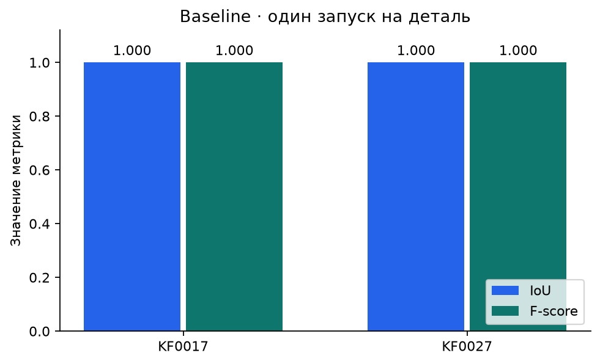
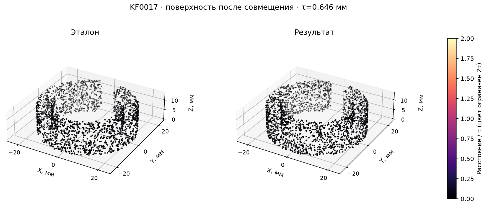
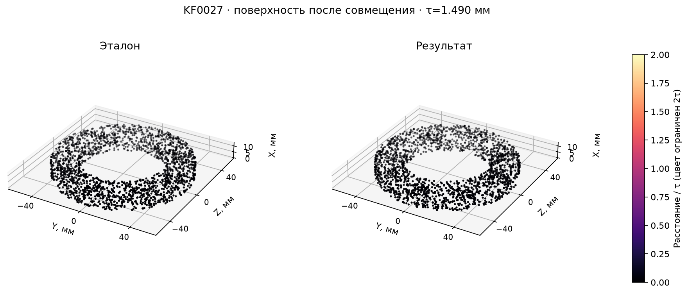

# ДЗ1 · От чертежа к CAD-модели

## Кратко

Исследуем, насколько AI-агент может построить новую 3D-деталь КОМПАС по изображению
чертежа. ДЗ1 фиксирует прямой baseline, небольшой проверенный набор и протокол оценки.
Преподаватель повторяет расчёт по сохранённым артефактам без КОМПАС и доступа к модели.

Работа сдаётся Pull Request в `ml-rnd`. Другой учебный предмет — ветка
`ml-system-design`; общие инструменты — `master`. [Правила веток](docs/branches.md).

## Быстрая проверка преподавателем

Нужны Python 3.12+ и `uv`; зависимости зафиксированы в `uv.lock`.

```bash
uv sync --locked --group eval
uv run --locked --group eval python -m harness.coursework check
uv run --locked --group eval python -m harness.coursework evaluate
uv run --locked --group eval python -m harness.coursework report
```

`evaluate` по умолчанию работает офлайн: создаёт отдельный повтор в `.hw01-work/replays`,
пересчитывает метрики и сравнивает их с сохранёнными результатами. КОМПАС, SSH,
авторизация Codex и соседний репозиторий для этого не нужны. Первичная установка
зависимостей требует доступа к реестру пакетов.

Поверхностные показатели пересчитываются по STL. Объёмный IoU вычисляется из сохранённых
объёмов и пересечений, ранее измеренных КОМПАС. Проверяются хеши моделей, сеток и запросов,
включая матрицу совмещения. Повтор **самой булевой операции** требует КОМПАС.
Численный допуск сравнения повторов: абсолютный и относительный `1e-6`.
Он относится только к численному повтору метрик, не к геометрическому порогу τ.
На выполненном локальном повторе расхождение основных метрик равно нулю;
перенос на другие версии библиотек этим утверждением не покрывается.
[Проверка в чистой копии](docs/assignments/hw-01/verification.md) выполнена отдельно.

## 1. Постановка задачи

Восстановить геометрию детали по её техническому чертежу и получить редактируемый
CAD-документ с конструктивными операциями. Практический смысл — сократить ручное
перенесение чертежей в CAD, сохранив возможность проверить и изменить результат.

Главная исследовательская гипотеза: промежуточный структурный паспорт чертежа поможет
лучше согласовать виды, размеры и элементы, чем прямое построение. Проверяемое ожидание
для следующего опыта — рост F-score без снижения IoU при том же общем бюджете.
**В ДЗ1 проверяется воспроизводимость baseline; эффект паспорта пока не измеряется.**

Ограничения: один лист и одна деталь; неоднозначные или отсутствующие размеры;
ограниченный набор операций моста; время работы; ошибки исходных пар.
Геометрическое сходство не удостоверяет технологичность, материал, шероховатость
и соответствие всем допускам. Редактируемое дерево — требование к построению,
но полноценный автоматический тест редактируемости в это ДЗ не входит.

## 2. Формализация

| Понятие | Определение |
|---|---|
| Тип задачи | AI-agent, условная генерация CAD |
| Единица наблюдения | Чертёж одной детали и проверенная эталонная модель |
| `X` | Исходный PNG; агенту разрешены увеличенные фрагменты этого же изображения |
| `y` | Целевая геометрия, представленная эталонной M3D; буквальное совпадение файла или дерева не требуется |
| Предсказание | Новая M3D, выбранная агентом через `finish`, плюс рецепт и отчёт |
| Одна попытка | Свежая изолированная сессия, включая внутренние исправления, в пределах общего бюджета |
| Доступно на inference | PNG, общая инструкция, справка API, ограниченный мост и ответы о собственных построениях |
| Недоступно на inference | M3D пары, CDW, оценки, QA пары, чужие результаты и история подготовки эксперимента |

## 3. Данные и EDA

Подробный анализ с выполненными ячейками, таблицами, чертежами и графиками —
[notebooks/hw01_eda.ipynb](notebooks/hw01_eda.ipynb).
[Инструкция запуска](notebooks/README.md) использует отдельное окружение Jupyter.

Исходный локальный корпус `e2e-27-v1` содержит 27 пар PNG–M3D с чертежами-источниками CDW:
10 деталей редуктора, 4 вала, 6 демонстраций шпоночных пазов и 7 примеров вырезов
по круговому массиву. Это группы происхождения, а не классы классификации.
PNG — чистые экспорты КОМПАС, не фотографии и не сканы. PDF в этой версии нет.

Для ДЗ зафиксирован [учебный набор](data/hw01/v1/README.md). Отбор сделан до генерации
по читаемости, наличию определяющих размеров и возможности проверить пару.
Результаты агента в выборе деталей не участвовали.

| Пара | Назначение | Обоснование |
|---|---|---|
| KF0011, зубчатое колесо | `dev` | Ранее использовалось в разработке; известно расхождение отверстия PNG и M3D |
| KF0017, прорезная втулка | `val` | Проверены размеры тела и прорези; новый запуск после фиксации настроек |
| KF0027, кольцо с отверстиями | `val` | Проверены кольцо, расположение и размеры отверстий, цековки, фаски |

Пропуски здесь — недостающие размеры и виды, а не пустые табличные ячейки. При просмотре
других листов найдены примеры без основных размеров длины и диаметра: такие входы могут
не определять единственную геометрию. У KF0011 PNG задаёт отверстие Ø32, M3D — Ø30,6;
поэтому его нельзя использовать для итоговой оценки правильности построения.

Семейства размечены по родству геометрий и исполнений, папка происхождения сохранена
отдельно. Набор мал и выбран целенаправленно: по нему нельзя оценить разнообразие
промышленного корпуса. Возможное знакомство предобученной модели с учебными примерами
не исключено и отдельно не измерено.

## 4. Baseline

Один агент `gpt-6-astra`, `reasoning_effort=high`: PNG → план построения → рецепт → M3D.
Он использует существующий мост с операциями выдавливания, вращения, выреза, фаски,
скругления и кругового массива. Можно исправлять собственный рецепт по ответам КОМПАС.
Паспорт, ансамбль, обучение весов и выбор лучшего запуска по эталонным метрикам отсутствуют.
Повторная генерация может отличаться из-за недетерминированности модели и изменений сервиса;
строго повторяемая часть поставки — оценка сохранённых результатов.

Простота baseline относится к маршруту, а не к размеру модели: это сильная готовая
модель в уже работающей инфраструктуре. Сравнение с локальной VLM — отдельный опыт.

Предобработка: PNG проверяется по SHA256 и копируется без изменений. Агент может
запрашивать фрагменты через `view_input`; обучаемых преобразований и OCR-разметки нет.
Настройки находятся в [конфигурации](configs/hw01/baseline.toml), инструкция —
[hw01_direct_v1](harness/prompts/hw01_direct_v1.md).

На деталь выделено 900 секунд и до 15 вызовов `build`, включая отклонённые рецепты.
Подготовка окружения и последующая оценка в этот бюджет не входят. Выбор результата
должен произойти до срока; сохранённая промежуточная модель без `finish` результатом
не считается. Незавершённые и неудачные попытки сохраняются.

## 5. Протокол оценки и утечки

Обучения весов нет. `dev` используется для проверки инструментов и инструкций,
`val` — для зафиксированного опыта. Перед `val` сохраняется `freeze.json` с хешами
конфигурации, кода, промптов и набора. На каждой проверочной детали выполняется один
запуск; его результат не заменяется удачным повтором. Остальной корпус не объявляется
независимым test-набором. При будущей настройке по этим двум деталям они становятся dev.

Основные метрики — **объёмный IoU и поверхностный F-score@τ**:

- `IoU = Vintersection / (Vprediction + Vreference − Vintersection)`;
- `F = 2PR/(P+R)`, где P и R — доли поверхности в пределах допуска от другой модели;
- расстояния считаются от равномерно выбранных по площади точек до треугольников;
- `τ = 0,01 × диагональ габарита эталона`; фактический τ в мм сохраняется в отчёте;
- совмещение допускает поворот и перенос, без подгонки масштаба и отражения.

Параметры и формулы взяты из [cad-eval-0.2.0](eval/geometry/METRICS.md).
Допуск является настройкой исследовательского протокола, не допуском изготовления.
Дополнительно публикуются валидность, Chamfer и диагностика ошибок, время и число
построений. Денежная стоимость неизвестна, если её не сообщает используемый клиент.

У каждой проверочной детали одинаковый вес. Провал генерации или таймаут — ноль;
ошибка измерителя, инфраструктуры или отсутствие измерений — `null` с причиной.
Неполное покрытие блокирует итоговое среднее. Обнаруженная копия эталона отклоняется.
Две основные метрики не объединяются в искусственный балл; если будущие методы дают
конфликтующие изменения, показываются обе оценки без объявления общего победителя.

Изоляция технически проверяется перед запуском: запрет чтения эталонов, соседнего
репозитория и предыдущих результатов, обхода через симлинк и прямой сети. Построитель
получает чистую сессию без истории этого чата. Справка API не содержит решения детали.
Сама оценка выполняется после завершения генерации и не возвращается построителю.

## 6. Результаты и ошибки

Опыт выполнен 7 ноября 2026 года, после фиксации
[конфигурации](configs/hw01/freeze.json). Источники чисел:
[полные метрики](artifacts/hw01/baseline-v1/expected-metrics.json),
[пересечения КОМПАС](artifacts/hw01/baseline-v1/boolean-results.json),
[запуск втулки](artifacts/hw01/baseline-v1/generation/KF0017/generation.json) и
[запуск кольца](artifacts/hw01/baseline-v1/generation/KF0027/generation.json).

| Деталь | IoU | F-score@τ | τ, мм | Валидность | Время, с | Вызовы build |
|---|---:|---:|---:|---|---:|---:|
| KF0017 | 1,000000 | 1,000000 | 0,645605 | Валидна, одно тело | 181,9 | 2 |
| KF0027 | 1,000000 | 1,000000 | 1,489659 | Валидна, одно тело | 306,5 | 5 |
| Среднее по двум | **1,000000** | **1,000000** | — | VSR = 1,0; IR = 0,0 | 244,2 | 3,5 |

Таблица округлена: средний IoU в JSON равен 0,9999999999999727. Оценены обе
запланированные детали, пропусков основных метрик нет. Копирование эталона не обнаружено
по хешу M3D, отпечатку дерева и свойствам документа. Это проверка отсутствия совпадений,
а не доказательство отсутствия знакомства модели с примерами при предобучении.



Карты ниже показывают точки поверхности после совмещения; цвет — расстояние до другой
поверхности, делённое на τ. У втулки максимальное измеренное расстояние около
`1,2 × 10⁻¹³` мм, у кольца — `0,007487` мм. Последнее меньше заданного отклонения аппроксимации
STL `chord_mm=0,01` и согласуется с различием сеток; по этим измерениям нельзя
приписать его ошибке чтения чертежа. F-score = 1 означает попадание всех выбранных
точек в исследовательский порог, а не проверку производственных допусков.




На этом небольшом `val` не обнаружено двух-трёх разных типов итоговых геометрических
ошибок. Вместо искусственных примеров фиксируем фактически наблюдённые ситуации:

- **Ошибка направления выреза внутри запуска.** У кольца первая попытка не уменьшила
  объём; КОМПАС отклонил операцию. Агент исправил направление в пределах того же
  бюджета. [Исходный ответ](artifacts/hw01/baseline-v1/generation/KF0027/attempts/attempt-0001/result.json).
  Это один неудачный вызов `build`, а не отдельный повтор проверочного запуска.
- **Геометрия не равна полному инженерному документу.** Материал, поля допусков и PMI
  не перенесены. Например, масса кольца в ответе построителя связана с плотностью
  по умолчанию и не подтверждает материал с листа.
  [Ограничения результата](artifacts/hw01/baseline-v1/generation/KF0027/report.md).
  Изменение параметров с перестроением сохранённого файла не испытывалось.
- **Ошибка исходной пары.** В dev KF0011 отверстие Ø32 на листе расходится с Ø30,6
  в эталоне. Это дефект данных, не ошибка baseline на `val`. Отладочный запуск занял
  388,9 с и 6 построений; его оценка не входит в средние.
  [Доказательства dev](artifacts/hw01/baseline-v1/generation/KF0011/generation.json),
  [описание набора](data/hw01/v1/README.md).

Рецепты, ответы попыток и PNG выбранных моделей находятся в `generation/<ID>/`.
Расход токенов сохранён в `generation.json`; денежная стоимость не сообщалась клиентом
и оставлена `null`. Графики повторяются командой `uv run --group eval python -m scripts.plot_hw01`.

## 7. Выводы и следующие вопросы

ДЗ адаптирует обучение к запуску AI-агента: вместо `train.py` используется `generate`.
Но требования к фиксированным настройкам, отделению отладки от проверки и сохранению
результатов остаются. K-fold, bootstrap и оценка устойчивости по сидам в этом пилоте
не выполняются: два объекта и один запуск на объект не дают оснований для таких выводов.

Следующие проверяемые вопросы:

1. Даёт ли паспорт рост F-score без снижения IoU при том же общем бюджете?
2. Улучшают ли увеличенные фрагменты восстановление мелких элементов при том же бюджете?
3. Как переход от 15 к 30 минутам меняет валидность, качество геометрии и затраты?

Прямой агент восстановил номинальную геометрию обеих выбранных деталей за отведённый
бюджет. На этих объектах основные показатели достигли потолка; эффект паспорта
ими пока не доказан. Слабые места поставки — перенос инженерных атрибутов,
непроверенная редактируемость и неизвестная устойчивость на других деталях и повторах.
Разброс времени между втулкой и кольцом не является оценкой устойчивости запусков.

Следующая содержательная гипотеза — паспорт помогает на деталях с неоднозначными видами
и мелкими элементами. Для её проверки потребуется новый проверенный набор: текущий `val`
после этого разбора уже известен исследователю. Усложнять baseline по этим результатам
и затем повторно объявлять их независимой проверкой нельзя.

## Ответы на обязательные вопросы

| Вопрос | Ответ |
|---|---|
| Что предсказывается и почему? | Новая редактируемая CAD-модель по чертежу: нужна геометрия с операциями, а не похожая картинка. |
| Объект, X, y и inference? | Одна деталь; X — PNG листа, y — целевая геометрия в M3D; агент видит PNG, общие инструкции и свои построения. |
| Метрика и validation protocol? | IoU и F-score@1% диагонали; один замороженный запуск на каждую из двух проверенных деталей, семейства отделены от dev. Это пилот, не оценка всего корпуса. |
| Baseline, preprocessing и признаки? | Прямой gpt-6-astra/high; PNG без изменения байтов, разрешён просмотр фрагментов, обучения и инженерных признаков по эталону нет. Простой маршрут со сильной готовой моделью. |
| Ошибки, leakage и следующая гипотеза? | Был исправленный вырез, инженерные атрибуты не перенесены; эталоны изолированы, риск предобучения неизвестен. Далее — паспорт при том же бюджете на новом наборе. |

## Полный запуск и устройство репозитория

Полный опыт требует macOS с Codex CLI 0.166.0, авторизации выбранной модели,
Windows с уже открытым КОМПАС-3D v25 Study и настроенного SSH/MCP.
[Подключение](docs/remote_kompas.md). Доступ к КОМПАС выполняется последовательно,
оценка открывает копии; документы человека не меняются.

Полный снимок доступных агенту инструкций сохранён в `generation/<ID>/instructions/`,
хеши исходной рабочей области — в `builder-files.json`. Перед новой генерацией
в чистой копии восстановите дополнительную инструкцию библиотеки из снимка:

```bash
cp artifacts/hw01/baseline-v1/generation/KF0017/instructions/library.md vendor/kompas_lib/AGENTS.md
```

Этот локальный файл остаётся вне Git; корневой `AGENTS.md` также не добавляется в индекс.
Для офлайн-оценки инструкция библиотеки не требуется.

```bash
uv run python -m harness.coursework generate --split dev --settings /path/to/settings.json
uv run python -m harness.coursework generate --split val --settings /path/to/settings.json
uv run --group eval python -m harness.coursework evaluate --settings /path/to/settings.json
```

Это последовательность подготовки новой версии опыта. Для новой генерации после
заморозки создайте конфиг в отдельном каталоге с новым `experiment_id` и новым путём `bundle`,
затем передавайте его через `--config`. Соседний `freeze.json` появится перед новым `val`:
сдаваемая версия и предыдущие результаты не перезаписываются. Если исход удалённой
операции неизвестен, запуск блокируется до проверки оператором; КОМПАС принудительно
не завершается. Пример локальных настроек — [settings.example.json](configs/hw01/settings.example.json).

| Путь | Назначение |
|---|---|
| `configs/hw01/` | Настройки и фиксация опыта |
| `data/hw01/v1/` | Входы, эталоны, проверка пар и контрольные суммы |
| `harness/` | Генератор, изоляция и ограничения построения |
| `eval/` | Зафиксированный снимок общего оценщика с происхождением в SOURCE.json |
| `artifacts/hw01/` | Публичный комплект проверочных результатов |
| `tests/` | Проверки harness и учебного процесса |
| `runs/`, `.hw01-work/` | Локальные оригиналы прогонов и новые повторы оценки |
| `evaluation/` | Исторический оценщик KF0011; в ДЗ используется снимок `eval/` |

Публичный комплект — отдельная производная копия локальной оценки. Скрипт
`scripts/publish_hw01_bundle.py` сохраняет числа и бинарные файлы, переносит
диагностические пути и добавляет ответы построения; журнал преобразования и хеши
исходного экспорта находятся в [publication.json](artifacts/hw01/baseline-v1/publication.json).
Локальные транспортные журналы и настройки подключения не публикуются.
Замороженный код генерации и оценки после `val` не менялся.

При подготовке новой поставки после live-оценки перенесите её экспорт из настроенного
`bundle` в отдельный локальный каталог и выполните:

```bash
uv run python -m scripts.publish_hw01_bundle \
  --source /path/to/local-export --output /path/to/public-bundle \
  --ledger /path/to/attempts.json
```

Скрипт не перезаписывает существующий публичный каталог. Для проверки уже сданного
комплекта этот этап не нужен — достаточно офлайн-команды в начале README.

Проверки кода:

```bash
uv run --group eval python -m unittest discover -s tests -v
uv run --group eval python -m pytest -q eval/geometry/tests
uv run pre-commit run --all-files
```
