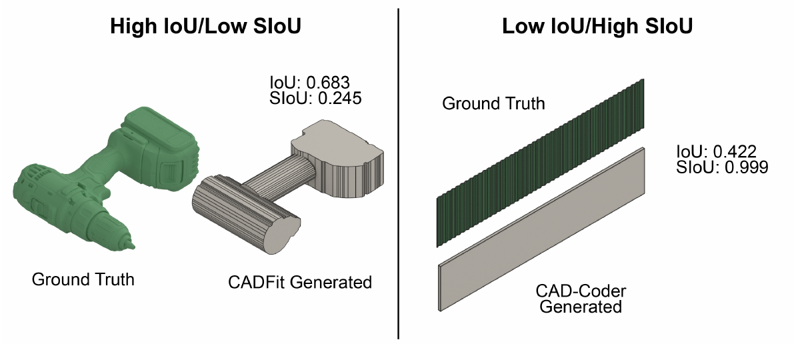
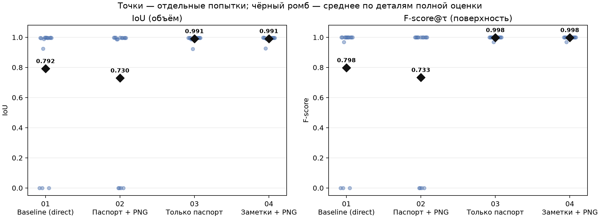
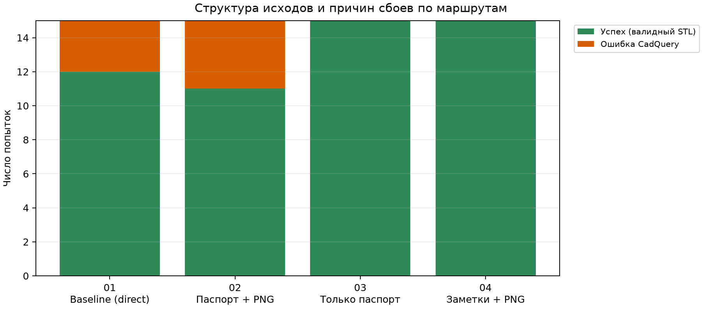

# Генерация 3D-модели по инженерному чертежу в CAD-системах

## Кратко

Проект исследует, может ли мультимодальная языковая модель восстановить геометрию механической детали по изображению её чертежа: от исходного PNG-листа и заданной ориентации к детерминированному CAD-рецепту, замкнутой 3D-модели STL и воспроизводимой офлайн-оценке (`IoU`, `F-score@τ`).

**CAD** — *Computer-Aided Design*, автоматизированное проектирование. Такие системы помогают инженерам создавать чертежи и пространственные модели деталей: втулок, валов, фланцев, шестерён и зубчатых колёс. Модель нужна, чтобы проверять геометрию, сопряжения и готовить дальнейшую конструкторскую работу ([краткое объяснение CAD](https://www.autodesk.com/solutions/cad-software)).

Эта работа — подпроект моей ВКР: в большом исследовании рассматривается генерация модели с **редактируемым деревом операций в КОМПАС-3D** — последовательностью эскизов, выдавливаний и вырезов. Для ДЗ построение перенесено на [CadQuery](https://cadquery.readthedocs.io/en/latest/intro.html), поэтому запуск, пересборка STL и оценка не требуют КОМПАС-3D и привязки к Windows.

Результат сохраняется в **STL** — формате описания поверхности треугольниками для просмотра, 3D-печати и геометрического сравнения ([описание STL](https://www.loc.gov/preservation/digital/formats/fdd/fdd000504.shtml)). STL приближает кривые грани сеткой и не хранит дерево операций, поэтому единицы (миллиметры) фиксируются протоколом, а отдельно в `runs/` сохраняется JSON-рецепт (`recipe.json`) для детерминированной пересборки модели.

- **ДЗ1 (`ml-rnd-hw-1`):** постановка задачи, формализация метрик (`IoU` и `F-score@τ`) и однопроходный `baseline`.
- **ДЗ2 (`ml-rnd-hw-2`, текущая ветка):** разделение на `dev`/`val` с контролем утечек, исследование №1 («влияние структурированного паспорта чертежа» и две абляции при равном бюджете), декларативные конфиги по вариантам, воспроизводимая история `runs/` и `results/`, а также переносимый трекинг в MLflow 3.18.

Подробный разбор гипотез, таблиц, абляций и ошибок находится в [EXPERIMENTS.md](EXPERIMENTS.md).

---

## Как запустить и посмотреть результат

Нужны **Python 3.12** и [**uv**](https://docs.astral.sh/uv/getting-started/installation/). Из корня клонированного репозитория без ключа API доступны все офлайн-проверки, пересчёт метрик, пересборка STL и просмотр истории в MLflow UI:

```bash
# 1. Установка зависимостей из lock-файла
uv sync --locked

# 2. Проверка кода, 67 офлайн-тестов, конфигов, промптов и манифеста датасета (без API)
uv run poe check

# 3. Офлайн-оценка, пересборка отчёта и просмотр/пересборка любого STL из runs/ (без API)
uv run poe exp evaluate --study 01-drawing-passport-val-all-r3
uv run poe exp report --study 01-drawing-passport-val-all-r3
uv run poe build KF0030 runs/01-drawing-passport-val-all-r3/03_passport_only/KF0030-r01-a001/recipe.json

# 4. Локальный интерфейс MLflow UI (http://127.0.0.1:5000): Runs, Charts, Traces, Sessions, Prompts
uv run poe tracking
```

Для нового запуска генерации через OpenAI API скопируйте [env.example](env.example) в `.env` и укажите `OPENAI_API_KEY`:

```bash
# Каталог исследований и проверка конфигурации без API
uv run poe exp list
uv run poe exp show 1
uv run poe exp check 1

# Отладочный прогон на одной детали dev или на всём dev
uv run poe exp run 1 --split dev --pair KF0012 --repeats 1 --concurrency 4
uv run poe exp run 1 --split dev --repeats 1 --concurrency 4

# Полная формальная валидация на val (4 варианта × 5 деталей × 3 повтора = 60 прогонов)
uv run poe exp run 1 --split val --repeats 3 --concurrency 4

# Офлайн-оценка, досинхронизация или полное удаление устаревшей серии
uv run poe exp evaluate --study <study>
uv run poe exp sync --study <study>
uv run poe exp purge --study <study>
```

Для просмотра сохранённых и эталонных `.stl` в `runs/` и `data/target/` прямо в VS Code удобно расширение [**vscode-stl-viewer**](https://marketplace.visualstudio.com/items?itemName=mtsmfm.vscode-stl-viewer) (*Open With → STL Viewer*). Список всех команд: `uv run poe help`.

```text
kompas_auto_draft/
├── README.md
├── EXPERIMENTS.md                          # Подробный отчёт по исследованию №1, абляциям и ошибкам
├── pyproject.toml, uv.lock                 # Зависимости (uv) и задачи CLI (poe)
├── env.example                             # Образец .env для OPENAI_API_KEY
├── configs/
│   └── experiments/
│       └── 01-drawing-passport/            # Исследование №1: study.yaml + папка под каждый эксперимент
│           ├── study.yaml                  # Метаданные, split, расписание и парные сравнения
│           ├── 01_baseline_direct/         # Эксперимент 01: pipeline.yaml, llm.yaml, cad.yaml, evaluation.yaml
│           ├── 02_passport_png/            # Эксперимент 02: pipeline.yaml, llm.yaml, cad.yaml, evaluation.yaml
│           ├── 03_passport_only/           # Эксперимент 03: pipeline.yaml, llm.yaml, cad.yaml, evaluation.yaml
│           └── 04_notes_png/               # Эксперимент 04: pipeline.yaml, llm.yaml, cad.yaml, evaluation.yaml
├── prompts/                                # Версионируемые в Git промпты + зеркало MLflow Prompt Registry
│   ├── cad_builder.md
│   ├── drawing_passport.md
│   └── drawing_notes.md
├── data/
│   ├── manifest.json                       # 10 dev + 5 val однолистовых пар, SHA256, family, orientation
│   ├── input/                              # 15 исходных чертежей PNG
│   └── target/                             # 15 эталонных STL в единой системе координат
├── notebooks/                              # EDA по dev-выборке (см. notebooks/README.md)
├── src/
│   ├── core/                               # Загрузка папочных конфигов, санитаризация, логирование
│   ├── schemas/                            # Pydantic-схемы Recipe и Passport (drawing-passport-2)
│   ├── llm/                                # Единый клиент OpenAI Agents SDK + подготовка PNG
│   ├── cad/                                # CadQuery-построитель и subprocess-воркер с таймаутом
│   ├── pipelines/                          # Протокол Pipeline и реестр стратегий
│   ├── evaluation/                         # Изолированный офлайн-оценщик IoU и F-score@τ
│   ├── experiments/                        # Async-раннер с дедупликацией чтения, отчёты, графики, CLI
│   └── tracking/                           # Переносимый локальный MLflow 3.18 (Runs, Traces, Sessions)
├── tests/                                  # Полностью офлайн-тесты (включая MockTransport)
├── runs/                                   # Артефакты прогонов: recipe.json, model.stl, паспорта, оценки, run.log
│                                           # (исключены только сырые HTTP-дампы debug/ и runs/_manual/)
├── results/                                # Переносимые отчёты серий: report.md, runs.csv, summary.json, *.png
└── mlflow/                                 # Локальный SQLite-трекер (tracking.db) и лёгкие артефакты
```

---

## 1. Постановка задачи

Инженерный чертёж содержит несколько видов, разрезы, размеры и примечания. Модель должна согласовать эту информацию и выдать пространственную геометрию детали: наружные контуры, ступени, отверстия, фаски и пазы. Практический смысл — автоматизация трудоёмкого восстановления 3D-модели по плоской КД.

В проекте оценивается **геометрическое сходство номинальной формы с эталоном**. Проверка допусков шероховатости, материала, прочности и технологичности не входит в скоринг: даже `IoU ≈ 1.0` не заменяет инженерный контроль.

**Исследовательская гипотеза ДЗ2:** предварительное извлечение структурированного JSON-паспорта чертежа (виды, элементы, размеры, связи, общие примечания) снизит пропуски размеров и ошибки привязки и повысит средний `F-score` и `IoU` по сравнению с однопроходным `baseline` при едином общем бюджете времени и выходных токенов.

---

## 2. Формализация

| Элемент | Определение |
|---|---|
| Тип задачи | Условная генерация 3D-геометрии с помощью мультимодального AI-пайплайна |
| Объект наблюдения | Одна однолистовая пара «чертёж детали — эталонная 3D-модель» |
| Вход `X` | Один PNG полного листа (`detail=high`, ≤ 4096 px) + ручная подсказка ориентации `orientation` |
| Цель `y` | Эталонная 3D-геометрия детали в формате STL (мм, базовая плоскость `Z=0`) |
| Предсказание `ŷ` | Замкнутый STL, построенный CadQuery по сгенерированному JSON-рецепту `Recipe` |
| Скрытые поля | `target_mesh`, `preparation`, `limitations` и `review` в запросы LLM не передаются |

---

## 3. Данные и EDA

Источник — исправленный выпуск `20261115-v2` учебных примеров КОМПАС-3D v25 Study из `kompas-drawings`. Отобраны **15 однолистовых пар** и разделены по геометрическим семействам (`family`) на два непересекающихся сплита (подробнее в [манифесте](data/manifest.json) и [EDA-ноутбуке](notebooks/EDA.ipynb)):

- **`dev` (10 деталей)** — отладка, доработка промптов, подбор лимитов схемы и EDA (`KF0011`, `KF0012`, `KF0016`, `KF0017`, `KF0018`, `KF0019`, `KF0025`, `KF0027`, `KF0029`, `KF0031`). Объёмы деталей различаются в **2187 раз** (от `4713` мм³ у шайбы `KF0019` до `10 307 258` мм³ у зубчатого колеса `KF0025`), разрешение PNG — от `4,4` до `26,1` Мп.
- **`val` (5 деталей)** — закрытая проверочная выборка, не использовавшаяся при настройке (`KF0030` фланец, `KF0107`/`KF0108`/`KF0109` группа втулок с внутренними пазами, `KF0111` вал с сегментными пазами). Близкий вариант `KF0106` исключён, а двухлистовые пары и литейные корпуса с условными поверхностями исключены из сравнения номинальной геометрии.

Известные расхождения и исправления источника зафиксированы в [data/manifest.json](data/manifest.json): для `KF0011` и `KF0012` в `20261115-v2` согласованы отверстия и пазы; у `KF0012` остаётся расхождение наружного габарита (`Ø245h12` на листе против `245,864` мм в STL), поэтому она оставлена только в `dev`; для `KF0018` эталон приведён к номинальному плоскому кольцу `Ø81/Ø64 × 6` мм; для `KF0012` применён только жёсткий поворот/перенос для выравнивания `Z=0`.

---

## 4. Пайплайн и конфигурации (Baseline и улучшения)

Все варианты сравниваются при единой модели, едином бюджете маршрута и **ровно одном** построении CadQuery без автоисправлений:

| Параметр | Значение (единое для вариантов `01..04`) |
|---|---|
| Модель и рассуждения | `gpt-6.1-sol`, `reasoning_effort = medium` |
| Подготовка PNG | RGB PNG, пропорциональный ресайз до ≤ `4096 px`, `image_detail = high` |
| Общий бюджет маршрута | `16384` выходных токенов (включая `reasoning`), `900 с` |
| Бюджет этапа 1 (чтение) | `≤ 8192` токенов; построитель получает строго остаток токенов и времени |
| Рецепт CadQuery | До `64` шагов `add`/`cut` (`circle`, `rectangle`, `polygon` до `512` вершин) вдоль `±Z` |
| Экспорт STL | Линейный допуск `0,01` мм, угловой `0,05` рад |

Конфигурация исследования №1 организована в [configs/experiments/01-drawing-passport/](configs/experiments/01-drawing-passport/): общий паспорт [study.yaml](configs/experiments/01-drawing-passport/study.yaml) и отдельная папка под каждый эксперимент с одинаковым набором YAML (`pipeline.yaml`, `llm.yaml`, `cad.yaml`, `evaluation.yaml`; [src/core/config.py](src/core/config.py) автоматически проверяет идентичность `llm`, `cad` и `evaluation` между папками):

1. [`01_baseline_direct`](configs/experiments/01-drawing-passport/01_baseline_direct/pipeline.yaml) (**baseline**): `PNG + orientation → рецепт → STL`.
2. [`02_passport_png`](configs/experiments/01-drawing-passport/02_passport_png/pipeline.yaml) (**улучшение**): `PNG → строгий JSON-паспорт (drawing-passport-2) → паспорт + PNG + orientation → рецепт → STL`.
3. [`03_passport_only`](configs/experiments/01-drawing-passport/03_passport_only/pipeline.yaml) (**абляция 1 — отключение PNG у построителя**): использует **тот же** `passport.json` внутри `(pair_id, repeat)`, но на 2-м этапе построитель не видит PNG.
4. [`04_notes_png`](configs/experiments/01-drawing-passport/04_notes_png/pipeline.yaml) (**абляция 2 — отключение строгой схемы**): заменяет JSON-паспорт свободными текстовыми заметками Markdown + PNG.

---

## 5. Протокол оценки

Оценка выполняется **полностью офлайн и независимо от агента** в [src/evaluation/metrics.py](src/evaluation/metrics.py):

- **Единые координаты без совмещения:** центр основной оси `(0, 0)`, базовый торец `Z=0`, материал `Z≥0`. Автоматический поворот, перенос и масштабирование не применяются.
- **IoU (объёмное совпадение):**

$$
\operatorname{IoU}(G,T)=\frac{\operatorname{Vol}(G\cap T)}{\operatorname{Vol}(G\cup T)}
$$

- **F-score@τ (близость поверхностей):** на каждой сетке равномерно по площади выбираются **8192 точки** (`seed=20261107`), измеряются расстояния до ближайших треугольников другой модели; порог $\tau = 0{,}01\sqrt{d_x^2+d_y^2+d_z^2}$ (1% диагонали габарита эталона):

$$
F_\tau=\frac{2P_\tau R_\tau}{P_\tau+R_\tau}
$$



*Иллюстрация из [CADBench, рис. 11](https://arxiv.org/pdf/2605.10873): `IoU` и `F-score@τ` дополняют друг друга, поэтому в один балл не объединяются.*

- **Честный знаменатель и агрегация:** сбой генерации (JSON, схема, лимит токенов, ошибка CadQuery или незамкнутый STL) даёт `0.0` по обеим метрикам; инфраструктурный сбой считается пропуском и блокирует закрытие серии. Сначала усредняются повторы внутри детали, затем все детали с равными весами.

---

## 6. Краткие результаты исследования №1

После отладки и исправлений CAD-пайплайна выполнены полные серии на **`val` (5 деталей × 3 повтора = 60 прогонов)** и **`dev` (10 деталей × 1 повтор = 40 прогонов)** без инфраструктурных сбоев.

### Итоги на `val` ([results/01-drawing-passport-val-all-r3/report.md](results/01-drawing-passport-val-all-r3/report.md))

| Вариант | Роль | Валидность | IoU (все 15) | F-score (все 15) | IoU (валидные) | Время, с | Вых. токены |
|---|---|---:|---:|---:|---:|---:|---:|
| `01_baseline_direct` | Baseline | 12/15 (`0,800`) | `0,7920` | `0,7979` | `0,9900` | `38,0` | `3216` |
| `02_passport_png` | Улучшение | 11/15 (`0,733`) | `0,7298` | `0,7333` | **`0,9951`** | `78,8` | `6734` |
| `03_passport_only` | Абляция 1 | **15/15 (`1,000`)** | **`0,9907`** | **`0,9978`** | `0,9907` | `81,4` | `7071` |
| `04_notes_png` | Абляция 2 | **15/15 (`1,000`)** | **`0,9913`** | **`0,9979`** | `0,9913` | `78,7` | `6048` |

На **`dev` (40/40)** все 4 варианта достигли **100% валидности (`10/10`)**, при этом все двухэтапные маршруты обошли `01_baseline_direct` (`IoU=0,9331`, `F-score=0,9380` → `02_passport_png` `IoU=0,9356`, `F-score=0,9459`; подробнее в [results/01-drawing-passport-dev-all-r1/report.md](results/01-drawing-passport-dev-all-r1/report.md)).





---

## 7. Выводы, следующие эксперименты и ответы на вопросы ДЗ

1. **Двухэтапное чтение чертежа действительно повышает качество на сложных деталях:** на `val` абляции `03_passport_only` (`+0,1987 IoU`, `+0,1999 F-score`, `+20%` валидности) и `04_notes_png` (`+0,1993 IoU`, `+0,2000 F-score`, `+20%` валидности) показали **15/15** валидных моделей с `F-score ≈ 0,998`. Предварительный шаг разгрузки чтения чертежа снимает часть геометрических ошибок и на `dev` (`40/40`), и на `val`.
2. **Почему просел `02_passport_png` (отрицательный результат по среднему `IoU`):** на 11 валидных прогонах `02_passport_png` показывает максимальную точность (`IoU = 0,9951`, `F-score = 1,0000`), но **4 сбоя CAD** (против 3 у baseline) дали нули в честном знаменателе. Все 7 сбоев на `val` вызваны **одной технической причиной** — пошаговой проверкой связности при генерации фасок: модель сначала строила тело от `z=1,0` или `z=1,6`, а на шаге 2 добавляла крайний срез фаски у `z=0,0`, получая временный разрыв до шага 3 (подробный разбор всех 7 рецептов — в [EXPERIMENTS.md](EXPERIMENTS.md)). Мы осознанно **не** меняли правила `builder.py` задним числом под `val`.
3. **Абляция схемы vs заметки:** на `val` свободные заметки `04_notes_png` и строгий паспорт `03_passport_only` практически сравнялись (`IoU 0,9913` vs `0,9907`), при этом заметки тратили меньше выходных токенов (`6048` vs `7071`). Преимущество JSON-паспорта здесь скорее инженерное (валидируемые ссылки и единицы).
4. **Следующие исследования:**
   - `02-cad-repair`: возврат ошибки CadQuery построителю (1–2 итерации исправления в том же бюджете) для устранения случайных сбоев порядка операций вроде шага 2 на фасках.
   - `03-visual-critique`: рендер сечений STL и визуальная сверка с исходным PNG для сложных деталей (`KF0011`, `KF0025`, `KF0029` из `dev`).

### Ответы на обязательные вопросы ДЗ

1. **Что предсказываем и зачем?** 3D-геометрию механической детали (STL через рецепт операций) по её плоскому чертежу PNG для автоматизации восстановления CAD-моделей.
2. **Что такое объект, X и y?** Объект — одна однолистовая пара деталь/чертёж; `X` — полный PNG листа + `orientation`; `y` — эталонный STL в единых координатах `Z≥0`.
3. **Какие метрики и валидация?** Объёмный `IoU` и поверхностный `F-score@τ` (`τ = 1%` диагонали габарита) без выравнивания. Настройка и отладка — на `10 dev`, финальная оценка — на `5 val × 3 повтора = 60` прогонах без пересечения `family` и хешей.
4. **Какой baseline и почему?** `01_baseline_direct`: один запрос к `gpt-6.1-sol` с PNG и `orientation` → рецепт → 1 сборка CadQuery, без промежуточного чтения и повторов.
5. **Ошибки, утечки и следующие шаги:** основные потери качества на `dev` — зубчатые профили и мелкие фаски (`KF0011`, `KF0025`), на `val` — 7 сбоев связности на шаге 2 при нарезке фасок снизу вверх; контроль утечек `dev`/`val` и скрытия эталона проверяется автоматически; следующий шаг — `02-cad-repair`.
