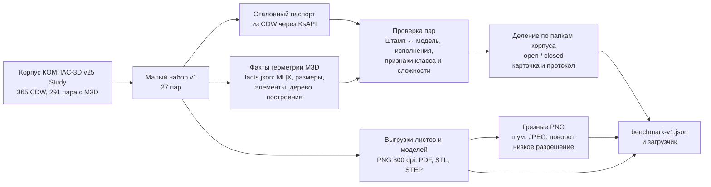
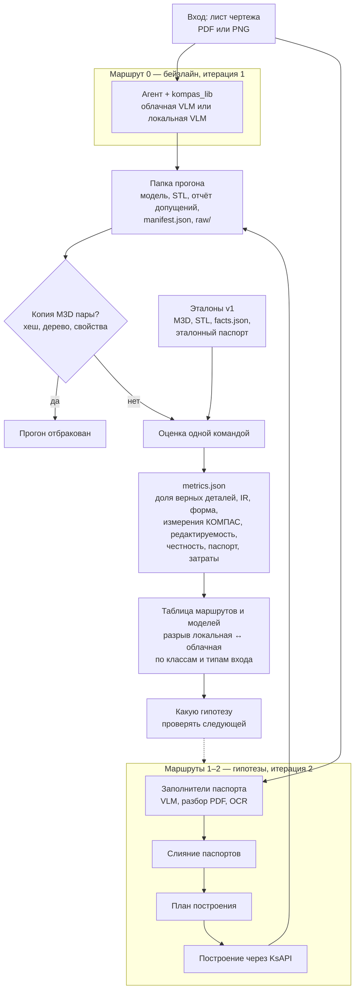

# ML System Design Doc: генерация 3D-модели по изображению чертежа в КОМПАС-3D

**AI-ассистент конструктора КОМПАС-3D, модуль «Чертёж → 3D». MVP, итерация 1**

| | |
|---|---|
| Статус | Черновик v0.1 |
| Дата | 2026-10-25 |
| Автор | [@BigMak1](https://github.com/BigMak1) |
| Заказчик | АСКОН (проект ИТМО × АСКОН «Разработка AI-ассистента конструктора для КОМПАС-3D») |
| Шаблон | [ML System Design Doc от Reliable ML](https://github.com/IrinaGoloshchapova/ml_system_design_doc_ru/blob/main/ML_System_Design_Doc_Template.md) |

Пометка ⚠ — допущение автора, которое ещё не согласовано с АСКОН. Все такие места
собраны в разделе [6. Открытые вопросы](#6-открытые-вопросы-и-допущения).

## Кратко

По чертежу детали (PDF или изображению листа) система строит **редактируемую** 3D-модель
в КОМПАС-3D и отчёт: что построено по прочитанному, что — по допущению, что не построено
и почему. В проде работают только **локальные open-source модели**.

Текущая итерация (до 20.01.2027) делает не модель, а **измерительный инструмент**:
e2e-датасет «лист чертежа → 3D-модель», метрики и два бейзлайна — облачный (верхняя
планка) и локальный. Следующая итерация (до конца апреля 2027) проверяет гипотезы,
которые сокращают разрыв между локальным и облачным решением: паспорт чертежа,
независимые проверки, циклы исправления, выбор модели.

---

## 1. Цели и предпосылки

### 1.1. Зачем идём в разработку продукта

**Проблема.** У инженера-конструктора на предприятии есть чертёж детали, но нет её
3D-модели, и модель он строит вручную. Простая деталь занимает 30 минут–1 час,
сложная — 1–2 дня. Типичные ситуации:

| Сценарий | Что есть у инженера | Что ему нужно |
|---|---|---|
| Оцифровка архива | PDF-выгрузки чертежей, моделей нет | Модель в КОМПАС, чтобы дальше с ней работать |
| Переход с другой CAD | Чертежи из другой системы | Те же детали моделями в КОМПАС |
| Проверка чертежа | Чертёж, в котором могут быть ошибки | Понять, хватает ли размеров и не противоречат ли они друг другу. По противоречивому чертежу модель не строится или не сходится с видами — это и есть сигнал |

**Бизнес-цель.** Сократить время инженера на получение редактируемой 3D-модели по
существующему чертежу: вместо часов и дней ручной работы — минуты работы системы и
короткая проверка результата. Модуль встраивается в AI-ассистента конструктора КОМПАС-3D.

**Почему ML.** Чтение чертежа — это сразу три задачи:

- **восприятие** — виды, разрезы, сечения, размеры с допусками, обозначения по ЕСКД;
- **рассуждение** — сопоставить изображения одного элемента в разных видах и
  восстановить конструктивные элементы: ступени, пазы, отверстия, фаски;
- **синтез программы построения** — последовательность операций КОМПАС через KsAPI.

Ручные правила не обобщаются на разнообразие деталей и оформления. Мультимодальные
модели (VLM) и агенты с инструментами уже решают часть задачи. В
[прогоне на валу 078.505](#8-ссылки) (2026-10-19) агент Codex (GPT-6) с библиотекой
`kompas_lib` за 37 минут построил модель из 11 операций; масса — 9,164 кг при 9,2 кг на
чертеже. Но:

1. это облачная модель, а в проде такие недоступны;
2. часть допущений агента осталась неотмеченной и нашлась только при просмотре человеком:
   строил и проверял один и тот же агент.

**Что такое успех для инженера.** Модель экономит время, только если она одновременно:

1. **правильная** — форма и размеры соответствуют чертежу и его требованиям;
2. **редактируемая** — это параметрическая модель КОМПАС: дерево построения из понятных
   операций, эскизы полностью определены, размеры можно менять. Не «мёртвое» тело и не сетка;
3. **честная** — всё, что построено по допущению или не построено, перечислено в отчёте.

**Анти-цель.** Модель построена, но с незаметными ошибками. Это хуже, чем отсутствие
модели: инженер тратит время на поиск ошибок, выигрыш пропадает, доверие к ассистенту
падает — «проще построить самому». Поэтому **частичная модель со списком «не построено
и почему» лучше полной модели со скрытой ошибкой**.

**Успех итерации 1 с точки зрения бизнеса** (до 20.01.2027). Есть измерительный инструмент,
которому доверяет АСКОН:

- версионированный e2e-датасет и протокол оценки;
- метрики, связанные с требованиями инженера и проверенные на заведомых ошибках;
- цифры двух бейзлайнов на открытой части датасета: облачного (верхняя планка) и
  локального. Видно, насколько локальное решение отстаёт и на каких классах деталей
  цепочка рвётся.

После этого решения о гипотезах, размере модели и железе принимаются по цифрам.

**Успех проекта** (ВКР — конец апреля 2027, дальше — прод). Локальная open-source модель с
харнесом (паспорт чертежа, проверки, циклы исправления) достигает согласованного с АСКОН
порога качества на закрытой части датасета и приближается к облачному бейзлайну. Решение
готово к встраиванию в AI-ассистента КОМПАС-3D. Доказанный отрицательный результат
(«локальные модели отстают на X, причины такие-то») — тоже результат.

### 1.2. Бизнес-требования и ограничения

**Бизнес-требования**

| ID | Требование | Чем проверяем |
|---|---|---|
| БТ-1 | **Правильность**: форма и размеры модели соответствуют чертежу | Доля полностью верных деталей, метрики формы и измерения КОМПАС (раздел 2.1) |
| БТ-2 | **Редактируемость**: параметрическая модель КОМПАС, понятное дерево операций, полностью определённые эскизы | Метрики редактируемости |
| БТ-3 | **Честность**: допущения и непостроенное явно перечислены в отчёте | Уверенные ошибки, доля частичных результатов и отказов |
| БТ-4 | **Время**: минуты на деталь, не часы | Время прогона из манифеста |
| БТ-5 | **Локальность**: в проде — только open-source модели в контуре заказчика | Модель-кандидат и её лицензия |
| БТ-6 | **Входы**: PDF из CAD (векторный) и растровое изображение листа | Метрики отдельно по типу входа |

**Бизнес-ограничения**

- **Модели.** В проде — только open-source модели, которые можно развернуть локально;
  лицензия должна разрешать коммерческое использование (Apache-2.0, MIT и т. п.).
  Облачные проприетарные модели (GPT, Claude, Gemini) — только для исследования:
  бейзлайн и верхняя планка, чтобы видеть, насколько отстают локальные.
- **Железо.** Сейчас АСКОН и заказчики готовы поддерживать модели среднего размера.
  ⚠ «Средний» здесь — порядка 7–35 млрд параметров на 1–2 GPU рабочей станции.
  Если модели на сотни миллиардов параметров дадут сильный прирост, заказчик может
  перейти на них. Такое решение принимается по зависимости «качество ↔ размер модели ↔ время».
- **Время на деталь.** Минуты, не часы. ⚠ Рабочий порог: до 15 минут на простую деталь
  и до 1 часа на сложную — заметно меньше ручной работы.
- **САПР.** КОМПАС-3D v25 (для разработки — Study) на Windows, автоматизация через KsAPI.
  Один экземпляр КОМПАС, к нему подключаются, а не запускают. Среда разработки — macOS и
  Windows 11 ARM в Parallels, КОМПАС x64 работает через эмуляцию, поэтому прогоны идут
  медленнее, чем на целевом железе.
- **Данные.** Основной корпус — учебная поставка КОМПАС-3D v25 Study. Файлы корпуса не
  распространяются за пределы проекта: у каждого участника они есть в папке установки,
  27 пар малого набора лежат в закрытом репозитории команды, для остального корпуса там
  только опись. Закрытые чертежи (конкурс 3D-ГТО.26 и закрытая часть деления) не
  используются для настройки промптов, порогов и алгоритмов.
- **Сроки.** 20.01.2027 — отчёт по индустриальному треку (итерация 1).
  Конец апреля 2027 — защита ВКР (итерация 2).

**Что ожидаем от итерации 1.** Датасет v1, документ метрик и одна команда оценки,
таблица двух бейзлайнов на открытой части. Подробно — в разделе 1.3.

**Бизнес-процесс в проде (будущий пилот)**

1. Инженер открывает в КОМПАС-3D чертёж детали (PDF или изображение) и вызывает ассистента.
2. Модуль локально читает лист и строит деталь через KsAPI.
3. Инженер получает модель и отчёт сверки: что построено по прочитанному, что по допущению,
   что не построено и почему, где модель расходится с видами чертежа.
4. Инженер проверяет отмеченные места, правит модель и сохраняет её.

В итерации 1 пилота с инженерами нет — оценка офлайн на датасете.

**Что считаем успешным пилотом (следующие итерации).** Высокая доля деталей, которые
инженер принял без правок или с мелкими правками; время инженера с ассистентом меньше
ручного построения на тех же деталях; нет принятых моделей с незамеченной ошибкой.
Числа фиксируются при подготовке пилота (раздел 3).

### 1.3. Что входит в скоуп итерации, что не входит

**Входит в итерацию 1 (до 20.01.2027)**

1. **E2E-датасет v1 «лист чертежа → M3D».**
   - Малый набор — 27 пар из корпуса КОМПАС: детали редуктора 078.505 (10), валы (4),
     листы шпоночных пазов (6), вырезы по круговому массиву (7). Из последних 4 — зубчатые
     колёса и червяк (KF0025, KF0026, KF0028, KF0029): они идут отдельным классом
     «передачи» (раздел 2.1).
   - Для каждой пары: **вход** — PNG 300 dpi и PDF листа, «грязные» варианты PNG;
     **эталон** — M3D, STL и STEP, факты геометрии `facts.json`, эталонный паспорт из CDW.
   - Проверка пар: исполнение на листе совпадает с измеренным, штамп совпадает со
     свойствами модели. Сырые признаки класса и сложности.
   - Деление на открытую и закрытую части **по папкам корпуса**: закрытая часть — целые
     папки; редуктор 078.505 — в открытой (на его вале уже отлаживали `kompas_lib` и прошлый
     прогон). Карточка набора с перекосами; протокол прогона; версия `benchmark-v1.json` с
     хешами всех файлов; загрузчик по версии и части.
2. **Метрики и контур оценки.**
   - Документ метрик с версией: e2e-уровень (форма, измерения КОМПАС, редактируемость,
     честность) и диагностический (паспорт).
   - Одна команда оценки: папка прогона → `metrics.json` и краткий отчёт.
   - Проверка метрик до того, как им верить: эталон против самого себя, заведомые искажения
     M3D (другой диаметр ступени, пропущенное отверстие, лишний паз, сдвиг элемента,
     поворот всей детали).
3. **Два бейзлайна** — маршрут 0: агент с `kompas_lib` строит модель прямо по чертежу,
   без паспорта. Открытая часть v1, одинаковый бюджет на деталь:
   - **облачный** — сильная проприетарная агентская модель, верхняя планка;
   - **локальный** — open-source VLM в том же харнесе.

**Не входит в итерацию 1**

- Гипотезы улучшения: паспорт, слияние заполнителей, циклы проверки, подбор и дообучение
  модели. Это итерация 2. Треки T1–T3 команды параллельно работают над паспортом;
  их маршруты оцениваются этим же контуром.
- Сборки, сборочные чертежи, многолистовые чертежи.
- Настоящие сканы, эскизы от руки, чертежи из других CAD. У них нет пары-модели —
  это следующая версия набора, оцениваются только по паспорту.
- Балансировка состава: не тела вращения, листовые детали, синтетические пары — версия v2.
- Проверка оформления по ЕСКД как отдельный продукт. Сценарий «проверка чертежа» —
  только побочный результат: отчёт о том, чего не хватило для построения.
- Интеграция в AI-ассистента КОМПАС, сервис и пилот с инженерами.
- Обратная задача (чертёж по 3D-модели) и поиск похожих деталей.

**Качество кода и воспроизводимость**

- Python 3.12+, `uv`, `ruff` (линтер и форматер), `pre-commit`, `pytest`, аннотации типов.
- Каждый показанный результат — папка прогона `runs/<маршрут>/<run_id>/`:
  - `manifest.json` — входы с SHA256, модель и настройки, версии промптов, набора и
    метрик, команда запуска, затраты (время, токены, деньги, железо);
  - `raw/` — сырые ответы и логи без правок;
  - `notes.md` — что заметили.

  Неудачные и оборванные прогоны сохраняются и входят в знаменатель.
- Набор идентифицируется версией и хешами файлов; метрики всегда указывают версии набора
  и документа метрик.
- Оценка запускается одной командой. Всё, что требует КОМПАС, снимается один раз: факты
  эталона — при сборке набора, факты построенной модели (`facts.json`, STL, дерево
  построения, состояние эскизов) — сразу после построения, тем же скриптом. Дальше
  сравнение идёт офлайн, а тесты метрик — без КОМПАС. В КОМПАС остаются только булевы
  операции с M3D пары (объёмный IoU).

**Планируемый технический долг**

- Снятие фактов геометрии (эталонов и построенных моделей) и объёмный IoU требуют живого
  КОМПАС на Windows — эти части не идут в CI. Без КОМПАС считается только сравнение уже
  снятых фактов.
- Набор v1 перекошен к телам вращения и одному стилю оформления. Выводы по нему —
  пилотные: с абсолютными числами и интервалами.
- Харнес бейзлайна завязан на `kompas_lib`. Если её API поменяется, бейзлайн перезапускается.
- ⚠ Локальные модели в итерации 1 запускаются на доступном железе: MacBook M5 32 ГБ — модели
  до ~30 млрд параметров в квантовании; для больших — арендованный GPU-сервер.
  Целевое железо заказчика при этом не воспроизводится.

### 1.4. Предпосылки решения

- **Единица данных — одна деталь: один лист чертежа ↔ одна модель M3D.** Деление на части —
  по папкам корпуса (семействам), а не по файлам: близкие детали одной папки не попадают
  в разные части. Семейств в v1 всего четыре, поэтому интервалы считаются бутстрепом по
  деталям, а выводы помечаются как пилотные.
- **Эталон геометрии — M3D пары, а не ручная разметка.** Корпус учебной поставки КОМПАС:
  365 CDW, у 291 модель найдена по имени файла. Около 245 пар — передачи из библиотеки
  «Валы и механические передачи», это отдельный класс. КОМПАС точно измеряет модель через
  KsAPI (МЦХ, размеры, конструктивные элементы), поэтому эталон есть у каждой пары без
  ручной работы.
- **Эталон чтения — то, что на листе.** Паспорт снимается из CDW как объекты (размер — с
  точным текстом и допуском, вид — с типом и масштабом), а не размечается по пикселям.
  Ошибка автора чертежа входит в эталон как есть.
- **Пара — это совпадение имени, а не проверенное соответствие.** Пара входит в оценку
  только после проверки: обозначение и масса из штампа против свойств модели, исполнение
  на листе против измеренного.
- **Вход — PDF и PNG.** PDF из CAD несёт точный текст размеров и векторные линии — именно
  это дало агенту верные номиналы в прогоне на валу. Растр — общий случай, ближе к сканам.
  Метрики показываются по типу входа отдельно.
- **Изоляция построителя.** Во время прогона подход видит только вход. M3D пар лежат в папке
  установки КОМПАС на каждой машине и в репозитории команды, поэтому рабочая папка агента —
  никогда не клон репозитория, а оценка сначала проверяет, что построенная модель — не копия
  M3D пары (хеш, дерево построения, свойства документа). Совпадение — прогон отбраковывается.
- **В итерации 1 без обучения.** Бейзлайны — готовые модели без дообучения (zero-shot) в
  агентском харнесе с инструментами КОМПАС. Данных для обучения мало (27 пар). Дообучение —
  гипотеза итерации 2, например на синтетических парах: КОМПАС умеет сделать ассоциативный
  чертёж из модели одной командой.
- **Опора на работу команды.** Командный репозиторий `kompas-drawings`: контракт паспорта 0.1,
  обёртка `kompas_lib` над KsAPI (`PartBuilder`, `measure_model`, `recognize_features`),
  MCP-сервер документации KsAPI, брифы задач датасета (R0–R2, D1–D3) и метрик (M1–M3).
  Этот документ описывает систему целиком и подробно — мой вклад: датасет, метрики и бейзлайны.
- **Где живёт код.** Код датасета, оценки и прогоны — в репозитории команды `kompas-drawings`,
  через PR: так треки T1–T3 оцениваются одним контуром. В этом репозитории (`kompas_auto_draft`) —
  дизайн-документ, учебные задания и черновые эксперименты.

---

## 2. Методология

### 2.1. Постановка задачи

**Техническая постановка — условная генерация программы построения CAD.** По листу
чертежа *x* (PNG и/или PDF) получить программу *p* — последовательность операций КОМПАС
через KsAPI. Её выполнение даёт параметрическую модель *y = exec(p)* и отчёт *r*: допущения
и непостроенное.

Близкие постановки в литературе — CAD code generation ([CAD-Recode](#8-ссылки),
[CAD-Coder](#8-ссылки), [Text2CAD-Bench](#8-ссылки)). Отличия нашей задачи:

- вход — инженерный чертёж с точными размерами и обозначениями ЕСКД, а не облако точек,
  текст или картинка формы;
- исполнитель и проверяющий — сам КОМПАС: модель можно перестроить, измерить и сравнить
  с эталоном точно, по B-rep.

**Решение — агент:** VLM/LLM и инструменты (KsAPI для построения и измерений, рендер модели
для сравнения с видами чертежа). Подзадачи внутри:

1. восприятие листа — виды, размеры, обозначения (VLM, OCR, разбор PDF);
2. реконструкция конструктивных элементов из нескольких видов;
3. синтез и исполнение программы построения;
4. самопроверка и исправление.

| Маршрут | Что это | Итерация |
|---|---|---|
| 0 | Агент + `kompas_lib` прямо по чертежу, без паспорта | 1 — бейзлайн |
| 1 | Чертёж → паспорт (VLM) → план → построение | 2 — гипотеза |
| 2 | Чертёж → паспорта нескольких заполнителей (VLM, разбор PDF, OCR) со слиянием → план → построение | 2 — гипотеза |

Все маршруты оцениваются одним контуром.

**Целевая переменная** — M3D пары (геометрия) и эталонный паспорт (что на листе).
В M3D может быть то, чего нет на чертеже, и наоборот. Такие расхождения помечаются, а не
засчитываются построителю как ошибка без разбора.

**Метрики.** Главный уровень — e2e: построенная модель против M3D пары. Паспорт — диагностика:
показывает, где потеряно качество до построения.

| Группа | Метрика | Что показывает | БТ |
|---|---|---|---|
| **Главная** | **Доля полностью верных деталей**: модель валидна, объёмный IoU ≥ τ, размерный состав совпадает в допуске, все элементы M3D на месте и нет лишних | Деталь, которую инженер примет без правок | БТ-1 |
| Валидность | Invalidity rate (IR) — доля чертежей без модели: ошибка построения, превышен бюджет, пустое или вырожденное тело | Как часто система не даёт ничего | БТ-1 |
| Форма | Chamfer distance, Surface IoU / F-score@τ по точкам STL после совмещения по главным осям инерции | Похожесть формы; сравнимость с литературой | БТ-1 |
| Измерения КОМПАС | Объёмный IoU булевыми операциями КОМПАС; ошибки МЦХ (объём, площадь, масса, центр масс); precision/recall размерного состава; покрытие и точность элементов | Какой элемент пропущен, какой размер не тот | БТ-1 |
| Редактируемость | Модель перестраивается без ошибок; доля полностью определённых эскизов; размеры чертежа заданы размерами эскизов и параметрами операций; число операций против дерева M3D | Можно ли с моделью работать дальше | БТ-2 |
| Честность | Уверенные ошибки — элементы, построенные как прочитанные, но неверные; доля построенного по допущению и сколько из него верно; доля частичных результатов и отказов | Можно ли доверять отчёту | БТ-3 |
| Паспорт (диагностика) | F1 по элементам; точность чтения размеров; точность отнесения размера к элементу; надёжность статусов | Где ошибка — в чтении или в построении | — |
| Затраты | Время на деталь, токены (облако), размер модели и железо (локально) | Цена качества | БТ-4, БТ-5 |

Правила подсчёта:

- Chamfer и IoU поощряют угадывание: правдоподобно додуманное отверстие улучшает цифру.
  Поэтому рядом всегда стоят покрытие, точность построенного и уверенные ошибки.
- Метрики считаются по всем деталям набора, провалы — в знаменателе.
- Результаты показываются с разрезами по классу, сложности и типу входа (PDF, чистый PNG,
  «грязный» PNG), с абсолютными числами и интервалами. На 27 парах разница в 1–2 детали — шум.
- Передачи (зубчатые колёса, червяк) — отдельный класс со своей строкой отчёта; в главную
  цифру без пометки не смешиваются. ⚠ Деталь класса считается верной, если зубья совпадают
  с M3D пары: на листе они изображены условно, параметры — в таблице зацепления.
- Закрытая часть — целые папки, поэтому доли классов в частях различаются. Результаты на
  закрытой части показываются по классам, а не одной цифрой: это строгая проверка переноса
  на детали, которых не было при настройке.
- Пороги τ и допуски сравнения назначаются на открытой части по разбросу повторных
  измерений и фиксируются до закрытой проверки.
- ⚠ Метрики редактируемости и честности — моё предложение к общему документу метрик
  команды; определения нужно согласовать.

**Бизнес-метрика (офлайн-оценка).** Сэкономленное время на деталь ≈ время ручного
построения − (время работы системы + время инженера на проверку и исправление).
Офлайн время проверки оценивается через число ошибок, которые надо найти и исправить;
в пилоте его измеряют на инженерах.

**Цели по метрикам**

- **Итерация 1:** метрики посчитаны для обоих бейзлайнов на открытой части, все проверки
  метрик проходят. Целевых значений для бейзлайнов нет — они и задают точку отсчёта.
- **Проект (ВКР):** ⚠ локальный маршрут даёт не меньше 90 % доли полностью верных деталей
  облачного бейзлайна на закрытой части, а уверенных ошибок у него не больше, чем у облачного.
  Порог и формулировку утверждает АСКОН до закрытой проверки.

### 2.2. Блок-схема решения

**Сборка датасета v1**

**Решение и контур оценки.** Бейзлайн (маршрут 0) и MVP (маршруты 1–2) различаются только
блоком построения, поэтому схема общая.

### 2.3. Этапы решения задачи

EDA ещё не проводился, поэтому этапы описаны на уровне входов, техники и результата.
После выгрузки фактов и проверки пар раздел уточняется.

#### Этап 1. Подготовка данных

| Данные | Есть ли сейчас | Что нужно для получения | Качество проверено |
|---|---|---|---|
| CDW и M3D корпуса | Да, папка установки КОМПАС v25 Study; опись `index.csv` | — | Частично: файлы на месте и совпадают по SHA256; соответствие пар — нет |
| PNG листов 300 dpi | 27 выгружены (сборка v26) | КОМПАС, скрипт выгрузки | Да, просмотр |
| PDF листов | Только у вала 078.505 (векторный PDF из КОМПАС; способ выгрузки не записан). Для корпуса — нет: в v26 сохранение в PDF через API пишет CDW | КОМПАС v25, рабочий способ выгрузки PDF через API или из интерфейса | Вал — да |
| STL и STEP моделей | Нет | КОМПАС, конвертеры KsAPI | Нет |
| `facts.json` (МЦХ, размеры, элементы, дерево) | Нет | КОМПАС, `kompas_lib`: `audit`, `measure_model`, `recognize_features` | Нет: нужен разброс повторных измерений |
| Эталонный паспорт из CDW | Нет; есть ручной паспорт вала | КОМПАС, `kompas_lib`: `Drawing.views`, `read_dims`, `Sheet.stamp` | Нет: сверить с ручным эталоном вала |
| «Грязные» PNG | Нет | Офлайн-скрипт с фиксированным зерном | — |
| Закрытые чертежи конкурса 3D-ГТО.26 | Да, 2 PDF корпусов | — | Только для финальной проверки |

**Результат этапа:** `benchmark-v1.json`, `split.csv`, карточка набора `DATASET.md`, протокол
`BENCHMARK.md`, загрузчик с тестом.

**Риски:**

- PDF не выгружается через API → вход v1 только PNG, PDF добавляется в следующей версии
  или выгружается из интерфейса КОМПАС с записью способа.
- Часть пар не сходится (другое исполнение, модель изменена после выпуска чертежа) → набор
  меньше 27; отброшенные пары и причины — в карточке.
- Измерения KsAPI нестабильны между повторами → пороги сравнения берутся от разброса.

#### Этап 2. Метрики и контур оценки

- **Вход:** эталоны этапа 1; модель вала из прошлого прогона (`shaft-final.m3d`) — первый
  «предсказанный» объект для отладки метрик. Это модель после ручных исправлений канавок,
  поэтому как результат бейзлайна она не считается.
- **Техника:**
  - форма — `trimesh` и `scipy` (выборка точек, KD-дерево, ICP), совмещение по главным осям
    инерции из `facts.json`;
  - измерения КОМПАС — KsAPI: булевы операции, МЦХ, размерный состав, элементы;
  - паспорт — судья трека T2 и TED (`apted`/`zss`);
  - редактируемость — чтение дерева построения и состояния эскизов через KsAPI;
  - честность — сопоставление отчёта построителя с эталоном.
- **Результат:** `METRICS.md` с версией, команда оценки с тестами, таблица по модели вала.
- **Проверка:** эталон против себя даёт идеальный результат; каждое заведомое искажение
  сдвигает свою метрику и не сдвигает чужие; поворот всей детали не штрафуется.
- **Риски:** KsAPI не отдаёт нужное измерение → метрика помечается «не считалась», а не нулём.
  Редактируемость трудно формализовать → начать с простых сигналов: эскизы определены,
  модель перестраивается без ошибок.

#### Этап 3. Бейзлайны

- **Вход:** открытая часть v1; одинаковый промпт («построй 3D-модель по чертежу, проверяй
  на каждом шаге»).
- **Облачный бейзлайн:** сильная агентская модель — как в прогоне на валу. Прогоны идут через
  подписку, ограничение — её квоты, поэтому в манифесте записываются токены и время.
- **Локальный бейзлайн:** ⚠ open-source VLM с коммерческой лицензией, кандидаты — семейство
  Qwen-VL и аналоги; выбор — по короткой проверке на одном чертеже.
- **Харнес:** ⚠ один и тот же агентский харнес для обеих моделей через OpenAI-совместимый API —
  меняется только модель, поэтому разрыв между бейзлайнами — это разрыв моделей. Инструменты —
  `kompas_lib` и рендер модели; рабочая папка только со входом (изоляция построителя).
  Конкретный агентский CLI выбирает исполнитель.
- **Бюджет на деталь:** ⚠ одинаковый лимит шагов агента и общий потолок по времени с запасом
  для локальной модели. Одинаковое время было бы нечестно к квантованной модели на ноутбуке.
- **Матрица прогонов:** ⚠ открытая часть × {PDF, чистый PNG} × {облачная, локальная} × 1 прогон;
  3 повтора на 3–5 деталях — для оценки разброса; «грязные» PNG — только на одной модели.
  При ~18 деталях открытой части это около 70 базовых прогонов и 100–150 вместе с повторами
  и «грязными» входами. По прогону на валу (37 минут) — порядка 70–100 часов работы КОМПАС:
  до 20.01.2027 это реально только при очереди прогонов без простоя.
- **Результат:** папки прогонов; таблица — доля верных деталей, IR, форма, измерения КОМПАС,
  редактируемость, честность, затраты; разрыв локальная ↔ облачная по классам; примеры ошибок
  с исходником, моделью и эталоном.
- **Риски:**
  - локальная модель не справляется с агентским циклом (IR ≈ 100 %) → это результат;
    более жёсткий харнес для локальной модели — уже гипотеза итерации 2;
  - прогоны медленные из-за эмуляции x64 на Windows ARM → бюджет на деталь и очередь прогонов.

#### Этап 4. Гипотезы (итерация 2, до конца апреля 2027)

Перед каждым прогоном записываются гипотеза, вход, выход и правила сравнения. Сравнение —
с бейзлайном на одинаковых входах.

- Паспорт чертежа как промежуточное представление (маршруты 1–2) — вместе с треками T1–T3.
- Независимая проверка и цикл исправления: наложение модели на виды чертежа в общем масштабе,
  сверка надписей с замерами граней.
- Векторный PDF как источник точных размеров против растра.
- Размер и семейство модели: кривая «качество ↔ размер ↔ время».
- Дообучение на синтетических парах «модель → ассоциативный чертёж».

**Бизнес-проверка результатов.** Еженедельный общий разбор с куратором: один прогон с
цифрами и одна находка. Отчёт итерации 1 — к 20.01.2027.

---

## 3. Подготовка пилота

### 3.1. Способ оценки пилота

Сначала — офлайн на закрытой части датасета с замороженными промптами и настройками.
Затем пилот с инженерами АСКОН: одни и те же детали строятся вручную и с ассистентом,
замеряются время и число правок.

### 3.2. Что считаем успешным пилотом

Критерии — в разделе 1.2. Числовые пороги фиксируются до пилота вместе с АСКОН.

### 3.3. Подготовка пилота

Затраты считаются по манифестам бейзлайнов: время на деталь, токены, железо. По ним
решается, какую модель можно позволить на железе заказчика.

---

## 4. Внедрение (предварительно)

Подробно раздел заполняется перед пилотом. Сейчас — эскиз:

- КОМПАС-3D с AI-ассистентом вызывает локальный сервис модуля «Чертёж → 3D»
  (FastAPI, Docker).
- Сервис обращается к серверу инференса open-source VLM в контуре заказчика
  (⚠ например, vLLM или llama.cpp).
- Построение идёт через KsAPI в запущенном КОМПАС на машине инженера.
- Чертежи и модели не покидают контур заказчика.

---

## 5. Риски

| Риск | Что сделаем |
|---|---|
| Набор мал и перекошен (тела вращения, один стиль ЕСКД, чистые выгрузки) → результаты не переносятся на чертежи заказчиков | Разрезы по классам и типу входа, «грязные» варианты, перекосы в карточке; балансировка — версия v2 |
| Утечка ответа: агент находит M3D пары на диске | Изоляция построителя и отбраковка копий до подсчёта метрик |
| Метрики формы поощряют угадывание | Рядом всегда покрытие, точность построенного и уверенные ошибки |
| Пара «чертёж ↔ модель» не соответствует (исполнение, правки) | Проверка пар до включения в оценку |
| Подгонка под закрытую часть | Журнал прогонов по закрытой части; после правки по её результатам часть перестаёт быть закрытой |
| Локальные модели доступного размера слишком слабы | Отрицательный результат допустим; кривая «качество ↔ размер» показывает, сколько нужно |
| Мало железа для экспериментов с локальными моделями | Квантованные модели на ноутбуке, аренда GPU для больших |
| Хрупкая автоматизация КОМПАС: один экземпляр, эмуляция x64 | Одна выгрузка за раз, бюджет времени, сохранение всех оборванных прогонов |
| Матрица бейзлайнов не успевает к 20.01.2027 (100–150 прогонов по ~40 минут на одном КОМПАС) | Сначала базовая матрица (PDF и чистый PNG, 1 прогон), повторы и «грязные» входы — по остатку времени |
| На 27 парах выводы статистически слабые | Абсолютные числа, бутстреп-интервалы по деталям, пометка «пилот» |
| Деление по папкам: в закрытой части оказывается класс, которого нет в открытой | Результаты по классам; низкая цифра на таком классе читается как плохой перенос, а не как переобучение |

---

## 6. Открытые вопросы и допущения

Согласовать с АСКОН и командой:

1. Числовой порог качества для проекта и кто его утверждает (сейчас ⚠ 90 % от облачного
   бейзлайна по доле полностью верных деталей).
2. Допустимое время на деталь (сейчас ⚠ до 15 минут — простая, до 1 часа — сложная).
3. «Модель среднего размера» в параметрах и GPU (сейчас ⚠ 7–35 млрд параметров, 1–2 GPU).
4. Определения метрик редактируемости и честности — войдут ли они в общий документ метрик.
5. Распределение задач датасета (R0–R2, D1–D3) и метрик (M1–M3) между участниками команды.
6. Железо для экспериментов с локальными моделями (сейчас ⚠ ноутбук + аренда GPU).
7. Формат отчёта построителя (допущения и непостроенное) для маршрута 0 — нужен, чтобы
   считать метрики честности у бейзлайна.
8. Какая подписка используется для облачного бейзлайна и хватит ли её квот на 40–70 прогонов.
9. Какие папки корпуса уходят в закрытую часть v1 (редуктор 078.505 остаётся в открытой).

---

## 7. Глоссарий

| Термин | Значение |
|---|---|
| CDW, M3D | Файлы КОМПАС: чертёж и 3D-модель детали |
| KsAPI | Программный интерфейс КОМПАС-3D для автоматизации |
| `kompas_lib` | Обёртка команды над KsAPI: построение, измерения, распознавание элементов |
| Паспорт чертежа | Промежуточный JSON: виды, элементы, размеры и откуда каждый взят; у каждой записи статус `observed` / `hypothesis` / `unresolved` / `rejected` |
| МЦХ | Массо-центровочные характеристики: объём, площадь, масса, центр масс, моменты инерции |
| Маршрут 0 / 1 / 2 | Способы получить модель: без паспорта / через паспорт / через слияние паспортов |
| Изоляция построителя | Во время прогона подход видит только вход, а не модели и эталоны |
| Уверенная ошибка | Утверждение или элемент, поданные как прочитанные, но неверные |
| Открытая и закрытая части | На открытой настраивают, закрытая — только для финальной проверки |
| Семейство | Папка корпуса: в v1 — редуктор 078.505, валы, шпоночные пазы, вырезы по круговому массиву. Деление набора идёт по семействам |

## 8. Ссылки

- Командный репозиторий `kompas-drawings` (закрытый): контракт паспорта, брифы задач
  R0–R2, D1–D3, M1–M3, T1–T3, отчёт о прогоне на валу `reference-runs/agent-shaft-20261019/`.
- [Шаблон ML System Design Doc от Reliable ML](https://github.com/IrinaGoloshchapova/ml_system_design_doc_ru)
- [CAD-Recode](https://arxiv.org/abs/2412.14042) — генерация CAD-кода по облаку точек.
- [CAD-Coder](https://arxiv.org/abs/2505.19713) — генерация CAD-кода.
- [Text2CAD-Bench](https://arxiv.org/abs/2605.18430), [CADBench](https://arxiv.org/abs/2605.10873) —
  протоколы оценки: Chamfer, IoU, invalidity rate.
- DeepCAD (Wu и др., 2021) — генеративная модель CAD-последовательностей, метрики Chamfer и invalid ratio.
- [CReFT-CAD / TriView2CAD](https://arxiv.org/abs/2506.00568) — ортографические проекции и размеры.
- [From Drawings to Decisions](https://arxiv.org/abs/2506.17374) — извлечение данных из инженерных чертежей.
- [eDOCr2](https://github.com/javvi51/edocr2) — OCR машиностроительных чертежей.
