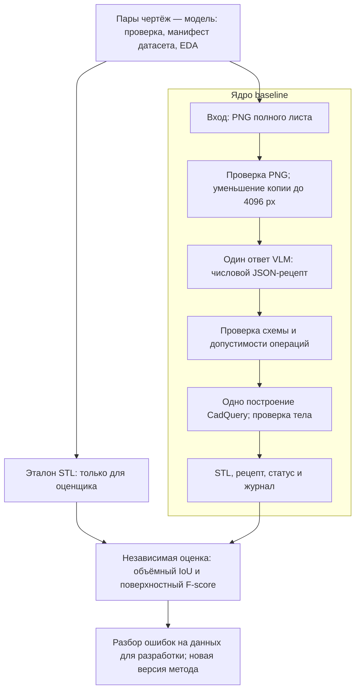
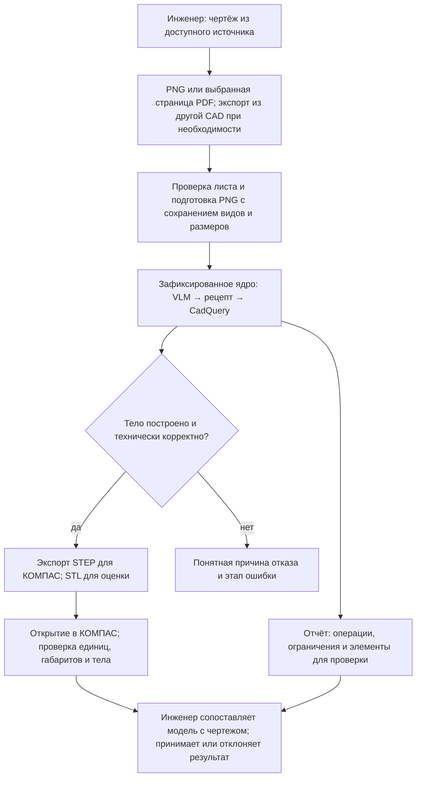

# ML System Design: генерация 3D-модели по чертежу для КОМПАС-3D

## Кратко

Для АСКОН разрабатывается система, которая поможет инженеру получить 3D-модель
детали по имеющемуся чертежу и продолжить работу с ней в КОМПАС-3D.
Цель — сократить ручное восстановление геометрии и в дальнейшем обеспечить
редактирование результата средствами КОМПАС. В документе спроектированы baseline
и MVP: от подготовки чертежа и восстановления геометрии до проверки результата
и передачи модели инженеру. Baseline использует готовую мультимодальную модель
и CadQuery; MVP добавляет подготовку пользовательского документа, передачу геометрии
в КОМПАС и отчёт об ограничениях. Приведены результаты EDA и план проверки решения;
результаты генерации и сравнения методов будут добавлены после экспериментов.

## 1. Цели и предпосылки

### 1.1. Зачем идём в разработку продукта

**Проблема.** У инженера есть чертёж детали, но нет подходящей 3D-модели для работы
в КОМПАС-3D. Это может быть документация из архива, чертёж от поставщика или результат
работы в другой CAD-системе. Иногда доступен исходный файл чертежа, иногда — только
PDF, скан или изображение листа.

Сейчас инженер вручную сопоставляет виды, разрезы и размеры, восстанавливает форму
и строит модель в САПР. Наличие чертежа в другой системе само по себе не решает эту
задачу: чертёж описывает деталь, но не обязательно содержит её готовую 3D-геометрию.

**Бизнес-цель.** Сократить время получения и подготовки 3D-модели для дальнейшей
конструкторской работы. Система разрабатывается для АСКОН как модуль AI-ассистента
конструктора в КОМПАС-3D и ориентирована на использование инженерами в рабочем процессе.

**Ожидаемая польза.** Инженер получает исходную геометрию для проверки и доработки.
По мере развития системы результат должен стать доступен для редактирования штатными
операциями КОМПАС: изменения размеров, отверстий, пазов и других элементов.
Это направление развития продукта; готовность такого редактирования на текущем этапе
не заявляется.

**Роль ML.** Мультимодальная модель должна сопоставить виды, разрезы, размерные надписи
и обозначения и предложить последовательность геометрических операций. Это трудно
описать единым набором правил для разных способов оформления чертежей. Построение
по этой последовательности и техническая проверка геометрии выполняются программно.
Рабочая гипотеза — такое разделение позволит автоматизировать часть ручного
восстановления; её предстоит проверить сравнением с работой инженера.

| Критерий пользы для инженера | Как планируется измерять |
|---|---|
| Меньше времени на получение пригодной модели | Сравнение ручного построения со временем подготовки входа, работы системы, проверки и исправления результата |
| Меньше ручного восстановления геометрии | Доля деталей, для которых полученный результат можно доработать без полного перестроения |
| Соответствие формы и существенных размеров чертежу | Проверка геометрии и инженерная оценка критических элементов |
| Возможность дальнейшего редактирования в КОМПАС | Проверка типовых изменений средствами САПР после реализации этой возможности |

Целевые значения и способ приёмки необходимо согласовать с АСКОН. Фактический выигрыш
во времени пока не измерен; результаты EDA не являются оценкой эффективности продукта.

### 1.2. Бизнес-требования и ограничения

**Целевой сценарий использования.** Инженер передаёт ассистенту доступный чертёж
детали. Система подготавливает данные для анализа, восстанавливает 3D-геометрию
и предоставляет результат для проверки и дальнейшей работы в КОМПАС-3D.
Инженер проверяет модель, уточняет неоднозначные места и при необходимости дорабатывает её.

| Требование к продукту | Что это означает |
|---|---|
| Работа с имеющейся документацией | Наличие исходного чертежа именно в КОМПАС не обязательно; рассматриваются документы из других CAD-систем, PDF и изображения |
| Сохранение смысла чертежа при подготовке | Виды, размеры, разрезы и обозначения должны оставаться доступными для анализа |
| Получение 3D-результата | Выходом служит модель детали для дальнейшей конструкторской работы; конечный результат не определяется одним исследовательским форматом файла |
| Понятные ограничения результата | Недостаток исходных данных и неподтверждённые элементы должны быть отмечены для инженера |
| Развитие редактируемости | Предусматривается дальнейшее построение модели, которую можно изменять средствами КОМПАС |
| Учёт требований заказчика к данным | Размещение вычислений и допустимость передачи чертежей определяются требованиями АСКОН и владельца документации |

Автоматический приём всех собственных форматов CAD-систем не предполагается заранее.
Если формат не поддерживается, для анализа может использоваться экспорт листа в PDF
или изображение. Для первого MVP планируется приём PNG и PDF с одним выбранным листом;
документы других CAD-систем предварительно экспортируются в эти форматы. Передача
модели в КОМПАС проектируется через STEP. Время обработки, стоимость запроса и допустимый
контур вычислений нужно согласовать до проверки MVP с инженерами.

Первый набор позволяет исследовать отдельные детали на одном листе. Поддержка сборок,
многолистовых документов, повреждённых сканов и неполной документации потребует
дополнительных данных и отдельных проверок.

### 1.3. Что входит в итерацию и что остаётся за её пределами

**Baseline** — исходный метод для сравнения качества: изображение полного листа →
один ответ мультимодальной модели → числовой рецепт построения → CadQuery →
3D-геометрия. Он позволяет проверить восстановление формы и рассчитывать метрики
без запуска КОМПАС. **MVP** — минимальный рабочий сценарий для инженера на основе
того же ядра: загрузить доступный чертёж, получить модель и ограничения результата,
открыть геометрию в КОМПАС и решить, пригодна ли она для дальнейшей работы.

| Область | Baseline | MVP |
|---|---|---|
| Вход | Подготовленный PNG одного листа | PNG или выбранная страница PDF; для других CAD — предварительный экспорт листа |
| Восстановление | Один ответ модели, ограниченный рецепт и одно построение | То же ядро; изменения допускаются после сравнения на данных для разработки |
| Выход | Геометрия в STL, рецепт и статус построения | Геометрия для КОМПАС в STEP, STL для оценки, рецепт и отчёт для инженера |
| Проверка | Техническая корректность и геометрические метрики на парных данных | Те же проверки, плюс сохранность геометрии при импорте и инженерная приёмка |
| Данные | Текущий набор с явно описанными ограничениями | Расширенные данные, включая другие источники, и независимая проверка по семействам |

Результат итерации — воспроизводимый baseline и MVP для согласованного класса
однодетальных чертежей. Готовность MVP означает, что весь сценарий работает и его
качество проверено по заранее зафиксированному протоколу; это не равнозначно готовности
к промышленной эксплуатации. В репозитории подготовлены датасет
и [EDA](../notebooks/EDA.ipynb), включены [код baseline](../src/agent),
[конфигурация](../configs/baseline.yaml) и [автономные тесты](../tests).
Состав набора описан в [манифесте датасета](../data/manifest.json) — списке пар
чертежей и моделей с путями к файлам и метаданными.
Результаты генерации пока не включены. План экспериментов, развитие MVP
и критерии завершения этапов описаны в разделе 2.3.

В итерацию не входят сборки, восстановление недостающей документации, произвольные
собственные форматы CAD и гарантированное распознавание повреждённых сканов.
Не обещается автоматическая пригодность модели для изготовления без проверки инженером.

Планируемый технический долг — штатное параметрическое дерево КОМПАС, расширение
набора операций и классов деталей, устойчивость к разным источникам чертежей,
промышленное размещение и эксплуатация. Импортированное тело в MVP не заменяет
восстановление исходной истории построения. Пилот и развёртывание будут описаны
в последующих разделах документа.

Код построения, интерфейс к ML-модели и независимый оценщик должны проверяться
по отдельности. Версии зависимостей, схема рецепта, промпт, параметры, входные хеши
и причины ошибок фиксируются; тесты не должны обращаться к платному API.
Воспроизводимость оценки сохранённого результата отделяется от повторного обращения
к ML-модели: новый ответ внешней модели может отличаться.

### 1.4. Предпосылки решения и смысл входных данных

**Чертёж и его изображение — разные представления.** Исходный CAD-документ может
содержать геометрические объекты, размерные обозначения, слои и другие структурированные
данные. Из него можно получить изображение листа для анализа. Если доступен только PNG,
эти CAD-объекты и связи в нём уже не представлены как редактируемые сущности.

PNG сохраняет вид листа, но его нельзя просто обратно преобразовать в исходный
чертёж со всей CAD-структурой. По изображению потребуется распознавать содержание
и восстанавливать геометрию. Поэтому задача не сводится к конвертации файла между форматами.

| Доступный материал | Как он рассматривается в системе |
|---|---|
| Чертёж КОМПАС или другой CAD-системы | Источник изображения листа; структурированные данные можно учитывать в дальнейшем, если они доступны |
| PDF-выгрузка чертежа | Документ, из страниц которого можно подготовить изображения для анализа |
| PNG, другое растровое изображение или скан | Уже доступное визуальное представление; наличие исходного CAD-файла не предполагается |

PNG — формат изображений **текущего датасета**, а не ограничение задачи только
изначально растровыми чертежами. На текущих данных ещё не проверена работа с другими
источниками и способами подготовки изображений.

Дополнительные предпосылки:

- Единица наблюдения — одна деталь, её чертёж и соответствующая эталонная геометрия.
- Размеры нужно извлекать из обозначений и взаимосвязей видов; измерение расстояний
  в пикселях само по себе не восстанавливает размеры детали.
- Для реального пользовательского запроса эталонной модели обычно нет. В датасете
  она нужна для будущей оценки и не должна становиться входом метода восстановления.
- Замкнутость и корректность геометрии не гарантируют соответствие чертежу.
- Неоднозначность или неполнота чертежа должна учитываться при оценке допустимого результата.

## 2. Методология

### 2.1. Постановка задачи

Задача — восстановление 3D-геометрии механической детали по её чертежу с последующим
использованием результата в КОМПАС-3D. Технически это условная генерация структурированного
рецепта построения по изображению, после которой детерминированный CAD-построитель
создаёт геометрию. Обучение собственной модели с нуля в baseline и первом MVP
не планируется: используется готовая модель, воспринимающая изображение и текст.

| Элемент | Определение |
|---|---|
| Объект наблюдения | Одна механическая деталь |
| Вход системы | Доступный чертёж: исходный документ, PDF или растровое представление |
| Вход в текущем датасете | PNG полного листа с видами, разрезами, размерами и надписями |
| Целевая величина | Геометрия соответствующей детали |
| Эталон для оценки | Подготовленное представление геометрии в STL; доступно только оценщику |
| Промежуточный результат | Числовой JSON-рецепт с геометрическими операциями, без исполняемого кода от ML-модели |
| Ожидаемый результат системы | 3D-модель для проверки и дальнейшей работы инженера в КОМПАС; возможность штатного редактирования развивается отдельно |

Формат исследовательского эталона не определяет окончательный формат результата
продукта. Получение подходящей геометрии, её передача в КОМПАС и создание редактируемой
модели — связанные задачи, готовность которых следует проверять по отдельности.

### 2.2. Блок-схема решения

Схемы показывают проектируемое решение. Подготовка датасета и EDA обеспечивают
эксперименты, но не заменяют путь от пользовательского чертежа до модели.

**Baseline: восстановление геометрии и независимая оценка.**

Построитель получает только изображение и общие настройки. Эталон, исходный M3D
и чужие результаты ему недоступны. Ошибка рецепта или построения завершает попытку
с соответствующим статусом; автоматического исправления и обратной связи от оценщика
внутри baseline нет. Новая версия метода — отдельный эксперимент после анализа
данных для разработки, а не дополнительная попытка на том же тестовом примере.

**MVP: получение модели инженером.**

У пользовательского запроса нет обязательной эталонной модели: IoU и F-score считаются
только в отдельной проверке на парных данных. В MVP инженер получает статус
технической проверки, а не неподтверждённую численную «точность». Передача в КОМПАС
добавляется к ядру baseline; восстановление штатного дерева операций — дальнейшее развитие.

Порядок разработки: данные и EDA → спецификация метода и протокола оценки → построитель
и проверка геометрии → проверка MVP в КОМПАС. Эксперименты с моделью и построителем
на этапах 2–3 выполняются итеративно на dev; итоговая версия фиксируется до test.
На каждом переходе проверяются выходы, описанные ниже; после этого можно переходить
к подготовке пилота.

### 2.3. Этапы решения задачи

#### Этап 1. Подготовка данных и EDA

**Вход этапа.** Доступные пары чертежей и моделей, сведения об источниках и требования
к классам деталей. Для baseline используются подготовленные PNG и STL. Для MVP набор
нужно дополнить примерами из целевого рабочего процесса; приём PDF и внешних CAD-экспортов
проверяется на таких примерах отдельно.

**Состав и происхождение.** Используется набор `cad-validation-10`: 10 пар,
целенаправленно выбранных по разнообразию формы из исходного манифеста датасета на 27 пар учебных
примеров КОМПАС-3D v25 Study. Девять деталей происходят из примера редуктора,
одна — из примера вала.
Состав и исходные имена файлов указаны в [манифесте датасета](../data/manifest.json).

| Сущность | Где находится | Проверка и назначение |
|---|---|---|
| Изображение чертежа | `data/input/` | PNG полного листа; проверяются декодирование, формат, разрешение и SHA256 |
| Эталонная геометрия | `data/target/` | STL; проверяются замкнутость, объём, связность, единицы и координаты |
| Карточка пары | `data/manifest.json` | Идентификатор, семейство, источник, роль набора, хеши и ограничения |
| Полная разметка размеров и видов | Отсутствует | Полнота распознавания текста и размерных связей пока не может проверяться по такой разметке |

**Целевая переменная.** Трёхмерная форма детали, а не текст рецепта: разные
последовательности операций могут давать одинаковую геометрию.

| Данные для проверки целевого результата | Источник и доступность | Ресурс для подготовки | Состояние качества |
|---|---|---|---|
| Эталонная 3D-геометрия | STL текущих пар; исходные модели из примеров КОМПАС | Инженер проверяет соответствие пары, DS готовит и проверяет представление | Технические проверки выполнены; есть известные различия с чертежами |
| Критические размеры, обязательные элементы и допустимые неоднозначности | Полной разметки нет; для MVP нужна разметка по чертежу | Инженер-конструктор и DS согласуют поля и правила проверки | Требуется подготовить до инженерной приёмки MVP |

**Входные признаки и служебные данные.** Ручной таблицы признаков для VLM нет:
она воспринимает изображение целиком. Файлы эталонов и замечания, содержащие сведения
о моделях, не передаются ей вместе с изображением.

| Данные | Источник и доступность | Ресурс для подготовки | Состояние качества |
|---|---|---|---|
| Виды, разрезы, размеры и надписи на PNG | Текущий набор; дополнительные документы для MVP ещё нужно получить | DS проверяет изображение, инженер оценивает читаемость и полноту | Декодирование проверено; полной разметки содержания нет |
| Страница PDF или экспорт листа из другой CAD | Для MVP от владельца документации | Инженер выбирает лист, разработчик готовит преобразование, DS проверяет результат | Репрезентативный набор пока отсутствует |
| Источник, семейство, хеши, роль выборки | Манифест датасета | DS и инженер проверяют происхождение и родство деталей | Хеши проверяются в EDA; группировку родственных исполнений нужно уточнить |

Здесь DS — специалист по данным и ML. Доступ к производственным данным АСКОН
или других предприятий пока не подтверждён; таблицы не предполагают наличия
готового корпоративного набора.

Исходные изображения — признаки модели; происхождение и семейство нужны для анализа
и разделения данных. Эталон и инженерная разметка служат целями оценки, а не признаками.

**Подготовка текущего набора.** Исходные CDW и M3D сопоставлялись как пары одной детали.
Чертежи выгружались в изображения, модели — в сеточное представление; проверялись
исполнение и ключевые размеры, фиксировались известные различия. В рабочем наборе
находятся уже подготовленные PNG и STL, поэтому повторять исходную выгрузку в КОМПАС
для EDA не требуется. Эта процедура описывает происхождение текущего набора,
а не обязательный формат документов будущего пользователя.

Единицы эталонной геометрии — миллиметры. Основная ось направлена по Z, задний торец
находится на Z=0, начало XY соответствует центру основной окружности; для корпуса —
оси главного отверстия. Эти соглашения сохранены в манифесте датасета. При расширении набора
их нужно проверять, а не заменять автоматической центровкой по габаритному ящику.

**Почему для геометрических данных выбран STL.** Этот формат хранит поверхность
в виде треугольников, которую можно читать, визуализировать и сравнивать обычными
Python-библиотеками без запуска КОМПАС. Это позволит рассчитывать геометрические
метрики на Windows, macOS и Linux независимо от платформы, на которой работает САПР.
По той же причине в baseline выбран CadQuery с выгрузкой STL: исследование качества
геометрии отделяется от интеграции с конкретным CAD-приложением. Для MVP дополнительно
планируется экспорт геометрического тела в STEP.

STL не содержит штатного параметрического дерева КОМПАС и не задаёт единицы измерения.
Сетку можно изменять, но это не равнозначно редактированию размеров и операций
CAD-модели. Использование STL для исследований не заменяет задачу получения
редактируемой модели в продукте и не предполагает автоматического восстановления
дерева операций из сетки.

**Процесс пополнения.** Автоматического потока данных сейчас нет. Для новой пары
нужно установить источник и допустимость использования, проверить исполнение,
подготовить изображение без потери значимых областей листа, проверить эталон и
добавить хеши и замечания в манифест датасета. При появлении других источников следует также
фиксировать исходную CAD-систему или вид документа и способ получения изображения.
Изменённый вход или эталон относится к новой версии набора; подгонять эталон под
будущий результат генератора нельзя.

**Результаты EDA.** В [ноутбуке](../notebooks/EDA.ipynb) сохранены таблицы,
галереи чертежей и моделей, распределения свойств и выводы:

- Все пары комплектны, PNG читаются; разрешение составляет 8,7–69,7 Мп.
  Файлы изображений занимают суммарно 4,16 МиБ, эталонные STL — 20,24 МиБ.
- Все эталонные сетки замкнуты и состоят из одного объёмного тела.
  Это подтверждает техническую пригодность сеток, но не полное соответствие чертежам.
- Объёмы деталей различаются примерно в 379 раз. Набор содержит втулки, кольца,
  вал, зубчатые детали, крышку и корпус с разной сложностью формы.
- Точных повторов PNG и STL по SHA256 не найдено. Геометрически близкие исполнения
  таким способом не выявляются.
- В отдельной проверке уменьшения до 4096 пикселей по длинной стороне меняются
  6 из 10 листов, минимальный линейный масштаб — 38,9% исходного. Это иллюстрация
  риска потери мелких надписей. Ограничение 4096 px выбрано как начальная настройка
  baseline; его достаточность для MVP нужно проверить отдельно.
- Выборка смещена к одному источнику и стилю оформления. В ней нет проверенной
  выборки чертежей из других CAD-систем, сканов и документации реальных предприятий.

**Качество исходных пар.** Проверялись ключевые размеры и исполнение; полной
экспертизы всех поверхностей и допусков не было. Известные различия сохранены
в [карточках пар](../data/manifest.json):

| Пара | Ограничение |
|---|---|
| KF0011 | Отверстие Ø32 на листе и Ø30,6 в исходной модели |
| KF0012 | Отверстие Ø54H8 против Ø55; наружный Ø245h12 против габарита 245,864 мм |
| KF0018 | Плоское кольцо со справочной толщиной 6* мм на листе; конические торцы и осевой габарит около 7,10644 мм в модели |

У KF0018 диаметры модели Ø65 и Ø82 находятся на границах интервалов Ø64±1 и Ø81±1;
это не выход за допуск. Отсутствие замечаний у остальных пар не означает полной
проверки соответствия. Известные различия не исправляются под изображение и не
скрываются при дальнейшем использовании набора.

**Достаточность и расширение.** Текущий набор позволяет проверить подготовку данных
и выявить основные ограничения, но недостаточен для вывода о качестве будущей системы
на документации предприятий. Приоритет расширения — новые семейства деталей,
чертежи из других CAD-систем и разные способы представления листа.

Первый ориентир расширения — ещё около 20 пар с разделением на данные для настройки
и отложенную проверку. Это предварительная оценка объёма работ, а не статистически
обоснованный минимум. Оставшиеся пары исходного манифеста датасета нужно проверить на новизну;
при недостатке разнообразия потребуются дополнительные разрешённые источники.

В текущем манифесте датасета все объекты имеют роль `val`. Набор уже изучался в предыдущей работе
и не является независимым итоговым тестом. Для новых данных разделение нужно выполнить
до настройки методов и по группам родственных деталей, а не случайно по файлам.
Метки `family` требуют проверки геометрического родства; папка источника сама по себе
не определяет такую группу. Пересечение публичных примеров с обучающими данными
готовых ML-моделей неизвестно.

**Конфиденциальность.** Текущий манифест датасета описывает учебные примеры, а не закрытые чертежи
заказчика. Отдельный аудит всех штампов на персональные данные не проведён, открытая
лицензия на исходный корпус здесь не заявляется. Для новых данных нужно проверять
условия использования, служебные надписи и допустимые способы обработки.
Если требуется обезличивание, создаётся отдельная версия изображения с сохранением
значимых размеров и фиксацией изменений. Производственные чертежи обрабатываются
только в согласованном с их владельцем контуре.

**Выводы для дальнейшего проектирования.** Нужно учитывать неоднозначность чертежа,
шум эталонов и потерю информации при уменьшении листа. Подготовленные изображения
и сетки позволяют перейти к экспериментам, но не подтверждают готовность системы
к работе с произвольными чертежами. Для этого понадобятся новые данные и проверка
на условиях, близких к работе инженера.

**Результат и условие перехода.** Для baseline — зафиксированный манифест датасета, PNG и STL
с проверяемыми хешами, выполненный EDA, единицы и координаты, перечень ограничений.
Это позволяет начать эксперименты на текущей рабочей выборке. Для MVP дополнительно
нужны согласованный класс входов, новые семейства и источники, разделение dev/test
до настройки и инженерная разметка критериев приёмки. До их появления допустимы
разработка и отладка, но не вывод о качестве на независимых данных.

#### Этап 2. Подготовка моделей, baseline и протокола оценки

**Вход этапа.** Зафиксированная версия датасета, ограничения из EDA, соглашения
о координатах и единицах, схема рецепта. Для MVP дополнительно нужны новые группы
деталей и инженерные критерии проверки. Единица обработки — один запрос по одной
детали; результат строится по запросу, периодический пересчёт не нужен. Версия метода
меняется после отдельного эксперимента, а не автоматически при поступлении чертежа.

**Baseline.** Готовая мультимодальная языковая модель (VLM) получает изображение
полного листа и инструкцию сформировать числовой JSON-рецепт. Через OpenAI Agents SDK
планируется ровно один запрос без инструментов, повторов и обратной связи от построителя.
После проверки ответа выполняется одно построение CadQuery. Генерация Python-кода,
выбор лучшего из нескольких ответов и исправление после сравнения с эталоном исключены.

Начальная спецификация закреплена в [конфигурации baseline](../configs/baseline.yaml),
реализация — в [коде агента и построителя](../src/agent).
Это отправная точка эксперимента; параметры не представлены как оптимальные.

| Параметр baseline | Начальное значение и смысл |
|---|---|
| Модель и режим рассуждений | `gpt-6.1-sol`, `medium`; перед экспериментом фиксируется доступная версия |
| Инструкция | `single-shot-cad-v1`: размеры в мм, согласованная ориентация, ограниченные операции, один полный рецепт |
| Изображение | Полный лист, `image_detail=high`, длинная сторона не более 4096 px |
| Ограничения ответа | До 8192 выходных токенов; ожидание ответа до 900 с; автоматические повторы отключены |
| Построение | CadQuery 2.7.0; точная версия геометрического ядра фиксируется в окружении |
| Сетка для оценки | Линейная точность экспорта 0,01 мм, угловая — 0,05 рад; относительная точность отключена |

Лимит ожидания API не является обещанием времени ответа продукта. Если выбранная модель
недоступна или не подходит под согласованный контур данных, замена фиксируется как новая
версия метода и проверяется по тому же протоколу.

**Предобработка и признаки для baseline.** PNG полностью декодируется и проверяется
до запроса. Если длинная сторона превышает 4096 px, создаётся уменьшенная копия
с сохранением пропорций методом LANCZOS; меньшие изображения не увеличиваются.
Лист не обрезается, ориентация не меняется, оригинал остаётся неизменным. Записываются
размеры и хеши оригинала и копии. OCR, выделение отдельных видов, бинаризация и ручной
перенос размеров в промпт в baseline не входят: модель должна интерпретировать лист.

**Предобработка и модель для MVP.** Начальный кандидат использует то же ядро.
Для PDF инженер выбирает одну страницу; она растеризуется, после чего проходит общие
проверки изображения. Начальное разрешение растеризации для проверки — 300 dpi,
последующее уменьшение учитывается в журнале. Это настройка эксперимента, достаточность
которой ещё нужно проверить на размерных надписях. Экспорт из другой CAD должен
сохранять все нужные виды и размеры. Нечитаемый, неполный или неподдерживаемый вход
должен возвращаться с причиной отказа; критерии читаемости проверяются на размеченных
примерах, а до автоматизации подтверждаются инженером.

После исходного сравнения проверяются изменения, связанные с рисками EDA:

| Гипотеза развития | Что сравниваем на данных для разработки | Условие включения в MVP |
|---|---|---|
| Полный лист и увеличенные фрагменты видов или размеров | Читаемость мелких надписей, геометрические метрики, затраты | Улучшение по зафиксированному протоколу без потери связей между видами |
| OCR и структурированные размеры как дополнительные признаки | Ошибки распознавания отдельно от ошибок построения | Есть проверенная разметка; неоднозначные размеры сохраняются как неопределённые |
| Расширение рецепта для вращения, конусов и скруглений | Ошибки представления формы и устойчивость CAD-операций | Новая схема проверяется отдельно; прежний baseline остаётся точкой сравнения |
| Другая готовая VLM или режим рассуждений | Те же входы, рецепты, бюджет и метрики | Согласованное соотношение качества, времени и стоимости |

Эти варианты — план экспериментов, а не обязательные компоненты первого MVP.
Изменяется один фактор за сравнение; промпт, разрешение и параметры выбираются
на dev. Отдельный цикл исправления по ошибкам CAD возможен в дальнейшем, но не входит
в зафиксированный baseline и не получает доступ к эталону. Дообучение весов потребует
существенно большего и отдельно размеченного набора; сейчас оно не планируется.

**Метрики и связь с задачей инженера.** Пусть `G` — построенная геометрия,
`T` — эталон. Используются две метрики, которые показывают разные типы ошибок.

| Метрика | Определение | Зачем нужна и чего не подтверждает |
|---|---|---|
| Объёмный IoU | `V(G ∩ T) / V(G ∪ T)` | Показывает лишний и недостающий материал; небольшое функциональное отверстие может мало влиять на общий объём |
| Поверхностный F-score | `2 × Pτ × Rτ / (Pτ + Rτ)`; при нулевой сумме — 0 | Показывает близость поверхностей; результат зависит от выбранного расстояния и не заменяет контроль допусков |
| Доля технически корректных моделей | Количество корректных тел / количество запросов | Показывает, как часто получен проверяемый результат; корректное тело может иметь неправильную форму |

Для IoU пересечение объёмов рассчитывается по замкнутым треугольным сеткам средствами
Trimesh и Manifold, без воксельного приближения. Для F-score на каждой сетке равномерно
по площади поверхности выбираются 8192 точки. `Pτ` — доля точек `G` на расстоянии
не более `τ` от поверхности `T`; `Rτ` — обратная доля для точек `T`. Измеряется расстояние
до треугольной поверхности, а не до ближайшей случайно выбранной точки другой сетки.
`τ = 0,01 × диагональ габаритного ящика T`; базовый seed — `20261107`, для `G` и `T`
используются смещения `+100` и `+101`. Этот порог — параметр сравнения формы,
а не производственный допуск. Допустимая численная погрешность объёмного пересечения
фиксируется отдельно (`intersection_roundoff_relative=1e-6`); большие нарушения
считаются ошибкой измерения.

Геометрия сравнивается в миллиметрах и в согласованных координатах, без автоматического
совмещения, поворота или изменения масштаба. Иначе можно скрыть ошибки размеров
и расположения элементов. Для новых классов деталей соглашения об ориентации задаются
до запуска и одинаково применяются к построению и подготовке эталона.

Для MVP к этим метрикам добавляются проверка критических размеров и наличия обязательных
элементов по инженерной разметке, доля принятых без полного перестроения моделей,
время подготовки и проверки, время исправлений и стоимость запроса. IoU и F-score
связаны с объёмом возможной ручной доработки, но сами по себе не доказывают экономию
времени. Эту связь нужно проверить на инженерных заданиях из раздела 1.1.

**Функция потерь.** В baseline и первом MVP веса готовой VLM не обучаются,
поэтому оптимизируемой функции потерь в проекте нет. IoU и F-score — метрики оценки
и выбора конфигурации, не функции обучения. Сравнивать рецепты по точному совпадению
JSON нецелесообразно: одна форма может быть построена разными последовательностями.

**Схема валидации.** Для baseline текущие 10 объектов `val` используются как рабочий
набор для проверки воспроизводимости и разбора ошибок. Результаты на нём нельзя
называть независимой оценкой обобщения. Обучающей выборки для подгонки весов нет.

Для MVP новые данные делятся на dev и отложенный test по семействам родственных
деталей до выбора модели и промпта. Разные исполнения и экспорты одного чертежа
остаются в одной группе; проверяется сходство геометрии, а не только SHA256.
Источники, качество изображения и сложность формы учитываются при составлении групп.
В test должны быть новые семейства и документы целевых источников; одного случайного
разделения текущих десяти примеров недостаточно. Если источников и групп недостаточно,
это ограничение фиксируется, а заключение о готовности MVP откладывается.

На dev допускается сравнение конфигураций, при достаточном числе семейств — проверка
с поочерёдным исключением группы. Затем фиксируются модель, промпт, схема, предобработка,
параметры построения и оценки. На test baseline и выбранный вариант проверяются
по одному и тому же заранее зафиксированному протоколу; настройка по его результатам
не проводится. При последующем использовании test для разработки он перестаёт быть
независимым и требуется новая итоговая выборка.

**Учёт неудач и повторяемость.** На одну деталь приходится одна попытка генерации.
Подтверждённый провал генерации, неверный рецепт или некорректная построенная сетка
дают нули геометрических метрик. Сбой API, инфраструктуры, повреждённый эталон или ошибка
измерителя дают отсутствующее значение с причиной. Отсутствующий файл без подтверждённой
причины не объявляется провалом модели. Для текущего набора среднее считается с одинаковым
весом всех десяти деталей и только после получения оценки каждой; пропуски не сокращают
знаменатель. Отдельно показываются число запросов и статусы всех отказов.

Seed фиксирует выборку поверхности для оценки, но не гарантирует одинаковые ответы VLM.
Для MVP повторные независимые запуски нужны для оценки разброса; их число и бюджет
согласуются до сравнения, сохраняются все попытки. Выбирать лучший ответ задним числом
нельзя. Повторное построение по сохранённому рецепту проверяет CAD-код, а не считается
новым запуском ML-модели.

**Интерпретация и риски.** Разбор выполняется по деталям: лист, числовой рецепт,
визуализация построенного тела и эталона, метрики, критические размеры и этап ошибки.
Ошибки разделяются на неверное чтение чертежа, неверную пространственную интерпретацию,
ограничение доступных операций, отказ CAD и ошибку измерения. Рецепт объясняет, что
было построено, но не является достоверным объяснением внутренних рассуждений VLM.

| Риск | Как учитывается |
|---|---|
| Потеря мелких надписей при уменьшении больших листов | Сравнение разрешений и фрагментов на dev; проверка критических надписей |
| Набор мал и смещён к одному источнику | Расширение по семействам и источникам; отдельный test; результаты по деталям без обобщения на все чертежи |
| Эталон расходится с чертежом | Пометки KF0011, KF0012, KF0018; инженерный разбор отдельно от геометрической оценки; пары не исключаются задним числом |
| Рецепт не выражает нужную форму | Фиксация приближения и проверка новой версии операций; отсутствие поддерживаемой операции не маскируется как точная реконструкция |
| Высокая метрика скрывает ошибку важного элемента | Отдельная проверка обязательных отверстий, пазов и размеров по разметке |
| Нестабильный ответ или смена версии внешней модели | Сохранение ответа, версии и настроек; учёт разброса и повторная проверка после изменения |

**Результат и условие перехода.** Для baseline — зафиксированные схема и конфигурация,
получение рецепта из изображения и спецификация независимой оценки с учётом отказов.
Построитель и оценщик проверяются на этапе 3; затем выполняется сравнение конфигураций.
Заранее заданного порога IoU или F-score для baseline нет: он должен дать исходную
точку сравнения. Для MVP — выбранная на dev конфигурация и протокол test, который
включает обе метрики, отказы, критические размеры, время и затраты.

Предварительное правило выбора MVP: на одинаковом наборе и при одинаковом учёте
ошибок средние IoU и F-score не ниже baseline, доля технически корректных результатов
не ниже baseline; ухудшения по отдельным деталям требуют разбора. Равенство допустимо,
если ядро сохранено и MVP добавляет пользовательский сценарий. Этого недостаточно
для бизнес-приёмки: требования к критическим размерам, времени и стоимости согласуются
с АСКОН до test. Численные результаты и выводы о выполнении этих условий будут
добавлены после экспериментов.

#### Этап 3. Построение геометрии и проверка CAD-результата

**Вход этапа.** Проверенный рецепт, версия построителя, единицы и координаты.
Цель — преобразовать ограниченный ответ модели в проверяемую геометрию и отделить
ошибку понимания чертежа от ошибки CAD-операций.

**Для baseline.** Рецепт содержит от 1 до 40 операций добавления или удаления материала.
Первой должна быть операция добавления. Профиль — круг, прямоугольник или замкнутый
многоугольник в XY; задаются высота `z`, глубина и направление выдавливания `+Z` или `−Z`.
Многоугольник содержит 3–128 вершин, имеет ненулевую площадь и не содержит совпадающих
соседних вершин. Числа конечны; координаты ограничены диапазоном от −1000 до 1000 мм,
высота — от 0 до 1000 мм, положительные размеры — не более 1000 мм. Это ограничения
контракта baseline, а не заявленный диапазон промышленного продукта.

Схема не допускает произвольные поля или исполняемый код. Встроенный построитель
создаёт профили, выполняет операции CadQuery и проверяет, что операция изменила материал,
а результат — одно корректное тело положительного объёма в согласованном полупространстве
`Z ≥ 0` с учётом численной погрешности. После экспорта STL повторно читается и проверяется
как объёмная сетка. Геометрическая валидность не означает соответствие чертежу.

Рецепт допускает приближение сложной формы доступными операциями. Например,
ограничение выдавливаниями затрудняет точное восстановление конических поверхностей
и скруглений, хотя сама библиотека CadQuery поддерживает более широкий набор операций.
Это ограничение baseline должно учитываться при интерпретации метрик.

**Для MVP.** Сохраняются строгий контракт и проверки. Если выбирается расширенный рецепт,
его версия и построитель проверяются отдельно; ограничения доступных операций и
приближения включаются в отчёт. Планируется расширить контракт сведениями о размере
с листа и неподтверждённом допущении, не влияющими на разрешённый набор CAD-команд.
Такие сведения проверяются инженером: самоотчёт модели не гарантирует, что все ошибки
и пропущенные элементы обнаружены. Пока такой разметки нет, выводится общее ограничение
метода и перечень операций, без заявления о полной проверке чертежа.

Для передачи в КОМПАС STEP экспортируется из геометрического тела CadQuery,
а не восстанавливается из STL. Сетка остаётся отдельным представлением для оценки.
Поддержка экспорта STEP описана в [документации CadQuery](https://cadquery.readthedocs.io/en/stable/importexport.html);
конкретный экспортёр и его параметры фиксируются при реализации.

**Проверки и обработка отказов.** Нужны автономные проверки схемы, построения по
заранее заданным рецептам, неверных профилей, пустого или несвязного результата,
единиц и экспортируемых файлов. Оценщик проверяется на одинаковой геометрии,
непересекающихся телах и случаях ошибки измерения. Тестовые рецепты проверяют механику
построителя, а не подменяют генерацию на датасете. После изменения построителя
сохранённые рецепты можно повторно выполнить без обращения к ML-модели.

Каждый отказ содержит этап и исходную причину: подготовка входа, получение ответа,
проверка рецепта, построение, экспорт или измерение. Сохраняются исходный ответ,
настройки, версии, хеши, длительности и сведения о расходе API. Секреты не попадают
в журналы. Неудача не выдаётся за готовую модель и не скрывается старым успешным файлом;
артефакты разных попыток различимы. Ограничения времени и памяти CAD-процесса
для MVP задаются после измерения на согласованном классе деталей.

**Результат и условие перехода.** Для baseline — STL и рецепт либо воспроизводимая
причина отказа; подтверждённая корректность схемы, построителя и оценщика на автономных
проверках. Для MVP — те же выходы, плюс STEP из того же тела и отчёт с границами
применимости. Проверка качества по чертежу остаётся отдельной от проверки экспорта.

#### Этап 4. Сценарий MVP и проверка результата в КОМПАС-3D

**Вход этапа.** Зафиксированный генератор, проверенный STEP, исходный чертёж,
отчёт о построении и согласованные инженерные задания. Это этап проверки решения
до пилота; организация пилота и промышленное развёртывание здесь не описываются.

**Для baseline.** Пользовательская интеграция не требуется. Достаточны воспроизводимый
запуск на подготовленном PNG, геометрия и технический отчёт. Метрики рассчитываются
по сохранённым файлам без обращения к VLM и без КОМПАС.

**Для MVP.** Планируется минимальный интерфейс: выбор документа и листа, запуск,
статус обработки, просмотр результата и передача модели в КОМПАС. Каждому запросу
соответствуют входной хеш, версия метода и отдельный результат. Явные состояния
«обработка», «готово к проверке» и «ошибка» не смешивают наличие геометрии
с её инженерной пригодностью. При неподдерживаемом формате предлагается экспорт листа;
при недостатке данных результат не объявляется достоверным.

Для первого MVP достаточно передачи STEP и открытия инженером в КОМПАС;
автоматизация этого действия внутри приложения может быть добавлена отдельно.
Импорт STEP предусмотрен [документацией КОМПАС-3D v25](https://help.ascon.ru/KOMPAS/25/ru-RU/dlg_step_import_settings.html).
Совместимость конкретного экспорта всё равно нужно проверить на целевой версии:
успешный импорт, миллиметры, ориентация, количество тел, габариты и объём после переноса.
Допуски сравнения при переносе фиксируются отдельно от производственных допусков детали.
Ошибка импорта возвращается как самостоятельный отказ, даже если STL успешно оценён.

Инженер сопоставляет исходные виды и размеры с результатом, отмечает пропуски и
необходимые исправления. Импортированное тело позволяет проверить передачу геометрии,
но не восстанавливает исходное дерево построения. Возможность конкретных доработок
нужно подтвердить отдельно; обещание редактирования всех исходных параметров
относится к последующему развитию модели в КОМПАС.

**Инженерная проверка и связь с бизнес-целью.** Для согласованных деталей фиксируются
критические элементы и размеры, решение инженера «пригодно для доработки» или «нужно
перестроить», причины и затраченное время. Время работы с системой включает подготовку
документа, ожидание, импорт, проверку и исправления; его сопоставляют с ручным построением
по тому же заданию. Это даёт основание для дальнейшего дизайна пилота, но само по себе
не доказывает эффект на всём потоке инженерных задач.

**Риски и условия завершения.** MVP не готов к переходу дальше, если теряет геометрию
при импорте, скрывает ограничения, требует независимого теста, которого ещё нет,
или не имеет согласованных критериев инженерной приёмки. Проверка сокращения времени
не должна игнорировать время исправлений и отказы. Если полученная геометрия не помогает
инженеру, потребуется пересмотреть представление результата и приоритет редактируемости.

Выход этапа — проверенный путь «документ → геометрия → КОМПАС → решение инженера»,
протокол технических и инженерных проверок, ограничения поддерживаемых документов
и список технического долга для следующей итерации. Для baseline выход ограничивается
автономным построением и оценкой. Результаты экспериментов, заключение о достижении
целевых показателей и раздел «3. Подготовка пилота» будут добавлены позднее.
